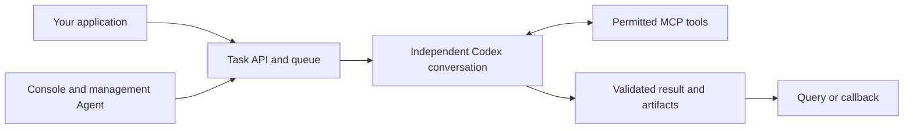

# Codex Agent Platform

**Turn repeatable AI work into a service that your application can call.** Send a task, let a Codex Agent do the work, and get a result in the format you agreed on.

[English](README.md) | [简体中文](README.zh-CN.md)

This self-hosted platform is for developers and small, trusted teams that want to put Codex to work inside an existing system: reviewing content, writing structured reports, producing illustrated stories, or running scheduled tasks. It handles the queue, task records, files and administration, so you can focus on the instructions and the result your application needs.

**Status: preview.** The Admin console supports Chinese and English: use the language selector on the sign-in page or in the top bar. Your browser remembers the choice. Switching languages preserves current form drafts and does not translate business prompts or task data. This README is also available in both languages. The platform uses your own ChatGPT account and runs models through OpenAI services. This is an independent project, not an official OpenAI product.

## Contents

- [Who it is for](#who-it-is-for)
- [What it does](#what-it-does)
- [Requirements](#requirements)
- [Install and authorize Codex](#install-and-authorize-codex)
- [Send your first task](#send-your-first-task)
- [Add your own work and schedules](#add-your-own-work-and-schedules)
- [Daily operation](#daily-operation)
- [Security risks and recommendations](#security-risks-and-recommendations)
- [Troubleshooting](#troubleshooting)
- [Development and documentation](#development-and-documentation)

## Who it is for

| You want to… | How the platform helps |
| --- | --- |
| Add AI work to a website, backend or internal tool | Submit structured input through an authenticated API and query the result or receive a callback. |
| Reuse a workflow without manually starting a chat each time | Save its instructions, input fields and output format as a plugin. Each request gets its own conversation. |
| Operate a small AI service | Use the console or management Agent to inspect failures, pause the queue, change settings and explicitly retry selected tasks. |

For example, a content system sends an article and review criteria. The Agent reviews it, then submits an approval decision and reasons. Your application consumes that JSON result without parsing a conversational reply.

The current release assumes one operator or a trusted team sharing administrative access and an API credential. It does not provide separate customer accounts, tenant isolation, role-based access control or customer billing. Plan a separate access layer before serving unrelated users.

## What it does

- **Runs a complete task autonomously.** Normal execution sends one full task message to one independent Codex conversation. The Agent chooses its steps, uses the permitted tools and submits its final result through `complete_task`.
- **Makes the input and output predictable.** A plugin declares its input fields, instructions, available capabilities and result schema. The service checks submitted data against that contract.
- **Keeps work and results on record.** Tasks have durable status, errors, execution details and downloadable image/text artifacts.
- **Provides an operations console and Agent.** Manage plugins, schedules, queue settings, task investigations and explicit retries through the same preset operations.
- **Applies ordinary settings without a restart.** Model, concurrency, pause, queue limits, timeouts, API credentials, HTTP destinations and management instructions are persisted and configurable.
- **Resumes incomplete work after a restart.** Recovery uses the existing task and Codex thread when their saved state is available. It may send an additional continuation message; completed or failed tasks do not automatically run again.



Here, an **Agent** is the AI that carries out the work. **MCP tools** are the specific operations the platform gives it, such as saving a file or submitting a result. You do not need to set up a separate MCP client to follow this guide.

Two generic examples are installed: `content.review` for text review, and `novel.illustrated` for illustrated fiction. Existing tools can save text, register generated images and send JSON to named HTTP destinations. Native image generation and web search depend on the plugin and your account's available capabilities.

**A plugin is configuration, not arbitrary code.** You can add work without changing the platform when the existing tools cover its needs. A new database integration, file format processor or other missing capability still needs implementation. The management Agent cannot edit source code, run arbitrary shell commands or administer unrelated services.

Each accepted API request creates new work, including an identical `request_id` and input. The platform does not use that field to deduplicate submissions. One initial message does not mean one model computation: tools and internal collaboration can involve several model steps. Plan caller-side retries and usage accordingly.

## Requirements

| Item | What you need |
| --- | --- |
| Server | A Linux host you control. The supplied deployment has been checked on Linux x86_64. |
| Host tools | Git, Bash, Docker Engine, Docker Compose v2 and curl 7.76+; SSH for remote console access. Check Docker with `docker version` and `docker compose version`. |
| Permissions | Permission to use Docker and create a private runtime directory. Commands below use `sudo`; omit it if your user already has the necessary permissions. |
| Network | The host must reach image/package registries during build. The Runner and Manager containers need outbound HTTPS to the OpenAI services used by Codex. Browser login also needs Internet access. |
| Account | Your own ChatGPT account with Codex access, sufficient usage allowance, and access to the model/tools you intend to use. Workspace policies may restrict them. |
| Local ports | Host loopback ports `3004` for the API and `3007` for Admin, or unused alternatives configured before first start. |

Docker includes Node.js, SQLite support and the pinned Codex CLI; you do **not** need to install them separately on the host for this deployment. No local GPU is needed. Model execution uses OpenAI services, so this is not an offline model server.

For a small trial, start with roughly 2 vCPUs, 4 GB RAM and 10 GB of free disk. These are planning suggestions, not measured minimum requirements. Images, retained task files, build cache and higher concurrency need additional capacity.

The current source pins Codex `0.159.2` and defaults to `gpt-6.1-sol`. Availability is determined by your account; configuration alone does not grant access. Check [OpenAI's current account and usage guidance](https://help.openai.com/en/articles/11369540-using-codex-with-your-chatgpt-plan) rather than assuming a particular plan has unlimited use.

## Install and authorize Codex

Run the server commands from the same cloned source directory. Keep runtime data separate from source. In this guide, `/data/codex-agent-platform` is the **runtime directory**.

### 1. Get the source and initialize private configuration

```bash
git clone https://github.com/NM1024/codex-agent-platform.git
cd codex-agent-platform
sudo ./deploy.sh init /data/codex-agent-platform
```

`init` creates two distinct random tokens, an independent initial Admin password and persistent data directories. It does not sign in, build images or run a model. Repeating it retains existing configuration and data.

Before first start, review `/data/codex-agent-platform/.env` locally. The generated defaults are enough for the bundled text example; no callback URL is required. Never use `.env.example` placeholder credentials in a deployment.

### 2. Build the three service images

```bash
sudo ./deploy.sh build /data/codex-agent-platform
```

This step installs the locked runtime dependencies into the images. Rebuild after a source or dependency upgrade. Routine configuration changes through Admin do not require a build.

### 3. Allow device-code login and sign in

First enable **device code login** in your ChatGPT account's **Settings → Security** (or **Security and login**) area; the label may vary with the interface language. In a managed workspace, an administrator may need to allow it in workspace permissions. See [OpenAI's device-code login instructions](https://developers.openai.com/codex/auth/#login-on-headless-devices).

Then, on the server:

```bash
sudo ./deploy.sh login /data/codex-agent-platform
```

1. Leave the terminal open. It prints a verification link and a temporary code.
2. Open the printed link in your own computer's browser and sign in to the intended account/workspace.
3. Enter the code from **your own terminal** and authorize the login you started.
4. Wait for the server terminal to report `Successfully logged in`.

A browser approval alone is not the final check; the CLI must finish. If the code expires or the page reports `invalid_auth_step`, cancel the pending login and start a fresh one with a new code. Never accept a code supplied by another person, and never post a code or login file in an issue.

The login is retained under the runtime `codex/` directory and is shared by Runner and Manager. Normal restarts do not require another login while that authorization remains valid. This release uses ChatGPT login; API-key login is not a supported alternative.

**Tool permissions are already configured by the platform.** You do not need to expose an MCP port publicly or enable unrestricted shell/file access. The bundled illustrated example already requests native image generation; your account must separately have that capability. Logging in does not guarantee access to every model or tool.

### 4. Start and check the services

```bash
sudo ./deploy.sh start /data/codex-agent-platform
sudo ./deploy.sh status /data/codex-agent-platform
curl -sS http://127.0.0.1:3004/healthz
curl -sS 'http://127.0.0.1:3004/readyz?type=content.review'
```

`start` uses the images already built. `/healthz` should return `{"alive":true}`. A successful readiness response includes `"ready":true`; otherwise read `reason` and the [troubleshooting table](#troubleshooting). Liveness, account readiness and successful completion of a real task are different checks.

### 5. Open Admin and change the initial password

On the server, read the password privately:

```bash
sudo cat /data/codex-agent-platform/manager/initial-password
```

On **your own computer**, keep this SSH tunnel open:

```bash
ssh -N -L 3007:127.0.0.1:3007 user@your-server
```

Replace `user@your-server` with your SSH login, then open [http://127.0.0.1:3007/admin/](http://127.0.0.1:3007/admin/). On a host with a local browser, you can open that address directly. Use the initial password, go to **系统配置** (System settings), and set a new Admin password. Password changes sign out existing web sessions. The initial-password file does not override a password already saved in the Manager database.

A public domain, HTTPS certificates and the external access gateway are managed by the deployment operator using their own infrastructure. This tutorial uses private SSH access. Keep internal service ports private; connection requirements for an existing gateway are described in the [deployment guide](docs/DEPLOYMENT.md#https-and-remote-console-access).

## Send your first task

This step starts real model work and uses your account's allowance. Start with one short text task before trying images or raising concurrency.

### 1. Submit

Read the current `INGRESS_TOKEN` value from your runtime `.env` privately, or use the value you subsequently saved in Admin. Run this in Bash **on the server** and paste only that token at the hidden prompt:

```bash
read -r -s -p 'Ingress token: ' INGRESS_TOKEN; printf '\n'
curl --fail-with-body -sS http://127.0.0.1:3004/v2/tasks \
  -H "Authorization: Bearer $INGRESS_TOKEN" \
  -H 'Content-Type: application/json' \
  -d '{"type":"content.review","request_id":"review-demo-1","input":{"content":"Our support team answers every message within one minute.","criteria":"Identify claims that need evidence. Explain your decision."}}'
```

HTTP `202` means the task was accepted, not finished. Copy its returned `task_id`.

### 2. Query the result

In the same terminal, replace the placeholder below with that ID:

```bash
TASK_ID='replace-with-returned-task-id'
curl --fail-with-body -sS "http://127.0.0.1:3004/v2/tasks/$TASK_ID" \
  -H "Authorization: Bearer $INGRESS_TOKEN"
unset INGRESS_TOKEN TASK_ID
```

Repeat the query if the task is still queued or running; do not resubmit the POST just to check progress. Admin's **任务记录** (Task records) shows the same task and its details.

| Status | Meaning |
| --- | --- |
| `queued` | Accepted and waiting for capacity, readiness or queue resumption. |
| `dispatching` / `running` | Starting or executing the Agent conversation. |
| `completing` | Checking and recording the submitted result. |
| `suspended` | Incomplete execution waiting for reconciliation/resumption. |
| `completed` | A result was accepted. Read its business fields to learn the outcome. |
| `failed` | Execution ended unsuccessfully. Read the error before retrying. |

For `content.review`, a completed result contains `approved` and `reasons`. An illustrative result is `{"approved":false,"reasons":["The one-minute response claim needs supporting evidence."]}`. A negative review is a valid result, not a platform failure.

### 3. Try other capabilities

- For the image example, check `/readyz?type=novel.illustrated`, then submit type `novel.illustrated` with input such as `{"premise":"A lighthouse keeper finds a letter from tomorrow.","chapters":1}`. Actual execution may still reveal account or model limitations. Image work usually takes longer and uses more allowance than a short text trial.
- Download an artifact through `GET /v2/tasks/{task_id}/artifacts/{artifact_id}` with API authentication, or open it in Admin.
- For final-result callbacks, configure a named HTTP destination in System settings, then choose it in the plugin's delivery configuration. A callback includes result and artifact metadata; it does not embed image files. See [plugins and delivery](docs/PLUGINS.md#result-and-delivery).

## Add your own work and schedules

In **业务插件** (Plugins), create a JSON definition with its input fields, complete task instructions, result format and permitted tools. Validate and save it, then submit a small trial. Existing examples are starting points; do not add secrets to instructions or input.

You can also ask the management Agent in **管理对话** (Management chat), for example:

> Create a text summary plugin. Accept a `text` field and return `summary` and `key_points`. Use no image generation or external HTTP tools. Save the plugin and tell me its request format; do not run a trial yet.

The Agent can configure existing capabilities; it cannot implement a missing tool. Review the saved definition and use a trial before connecting it to a real system. A plugin's instructions and result contract are retained for accepted tasks; later edits apply to new requests.

For scheduled work, use **定时计划** (Schedules). Choose a task or a management inspection, supply a five-field cron expression and an explicit timezone. For example, `0 9 * * *` runs daily at 09:00 in the selected timezone. Start with a low-frequency plan and verify its next run; disable plans when they are not needed. An enabled plan can consume allowance without you being online.

## Daily operation

- **Start small.** Default task concurrency is `1`. Increase gradually after measuring task duration, account limits and disk use. A request containing several items still has one root conversation; the Agent can use permitted internal collaboration.
- **Use pause for maintenance.** Pausing stops new dispatches while accepted requests queue up and current work continues. Inspect active tasks before a restart. Restore service access and saved files so incomplete conversations can resume.
- **Change ordinary settings in Admin or management MCP.** Saved values override initial `.env` defaults. Active execution keeps its launch settings; later work uses updated model/timeouts. Ports, mounts, runtime paths and internal credentials need deployment changes.
- **Treat retries as new work.** An explicit retry creates a related new task and preserves the old record. It may repeat model calls or external effects. An `unknown` delivery outcome needs investigation before another attempt.
- **Back up and watch storage.** Databases, conversation files and artifacts are persistent. There is no automatic retention policy or hard global spending cap in this preview. Stop services for a consistent backup of the full runtime directory; protect the backup like the live data.

Basic commands, run from the source directory:

```bash
sudo ./deploy.sh status /data/codex-agent-platform
sudo docker compose --env-file /data/codex-agent-platform/.env logs --tail=100 gateway runner manager
sudo ./deploy.sh stop /data/codex-agent-platform
```

For upgrades, back up first, fetch the intended release, build it, then start it. Do not delete runtime directories to upgrade. See [deployment and recovery](docs/DEPLOYMENT.md).

## Security risks and recommendations

**Deploy this as a privileged service for people you trust.** Agents act through the configured tools without a person approving every operation. Admin access can change plugins and schedules, submit work, alter credentials and request service restarts.

| Risk | What to do |
| --- | --- |
| Task data leaves the server | Prompts, relevant input and tool results go to OpenAI; configured HTTP destinations receive the data sent to them. Review the applicable account/workspace data controls and send only data you are authorized to process. Self-hosting the platform does not keep model processing local. |
| Stolen login state can be reused | Treat `codex/`, `.env`, databases and backups as secrets. Limit filesystem access, protect backups and enable appropriate account MFA. Never publish `auth.json` or paste it into chat or issues. |
| Stolen API/Admin credentials allow operations | Change the generated Admin password. Share neither Admin nor API access with untrusted users. Use an SSH tunnel/VPN for administration; if Internet-facing, add trusted HTTPS, access restrictions and login/API rate limits at your proxy. The application does not supply a full login-abuse prevention layer. |
| Malicious instructions can cause unwanted tool use | Treat task input, plugin prompts and external responses as untrusted. Give each plugin only the tools it needs. Configure only trusted HTTP destinations with narrowly scoped credentials; the HTTP tool can choose among configured destinations. Network egress restrictions add protection. |
| Autonomous work can use allowance or repeat side effects | Begin with concurrency `1`, small trials and few schedules. Monitor account usage. Investigate before retrying; final callback attempts are not automatically replayed after an ambiguous failure and cannot guarantee exactly-once remote effects. |
| AI output can be wrong | A valid JSON result does not prove factual accuracy, image quality or policy compliance. Set business review rules and add human review before consequential actions. |

The containers run as a non-root user with read-only root filesystems and no Docker socket. Tool policy restricts arbitrary shell, file editing and unrelated tools. These are useful boundaries, not a security audit or strong isolation between hostile tenants. Docker operators and server administrators remain trusted.

Admin password, API ingress token, internal `RUNNER_TOKEN` and ChatGPT login are different credentials. Changing one does not revoke the others. Put secrets into the relevant private configuration fields, not management chat messages; chat history and task records are persistent. If a credential leaks, revoke or rotate the affected credential and investigate its use. See [SECURITY.md](SECURITY.md) for reporting issues privately.

## Troubleshooting

| Symptom | What to check first |
| --- | --- |
| Device login fails before printing a code | Check outbound HTTPS and trusted CA access **inside the Runner container**, then account/workspace device-login permissions. Host `ping` alone does not test login. Do not disable TLS verification. |
| `invalid_auth_step` or an expired code | Stop that login attempt, generate a fresh code and use the printed link in a fresh browser session. Make sure you use the intended account/workspace. |
| `CHATGPT_LOGIN_REQUIRED` | Run the login command again and verify you are using the same runtime directory. Do not share or manually edit login tokens. |
| `RATE_LIMITED` or a model/tool access error | Check account usage, workspace restrictions and model availability. Lower concurrency or choose a model you can access in System settings. A readiness probe does not guarantee access to every model. |
| Image readiness is unavailable | Check the selected plugin's native image capability and your account's availability. Text-only work can be tested separately. There is no substitute image-provider fallback. |
| A task stays `queued` | Check queue pause, Runner readiness, active work and concurrency in Admin. Repeated POSTs create more tasks. |
| A tool reports that approval is required | Check that you are using the pinned build and its supplied MCP configuration. Account login and tool approval are different controls; do not enable unrestricted permissions as a workaround. |
| `RESULT_NOT_SUBMITTED` | The Agent turn ended without an accepted `complete_task` result. Inspect the final Agent message, tool errors and plugin instructions before deciding whether to retry. |
| Task completed but a callback failed or is `unknown` | Inspect delivery details and the receiving system. Completion and delivery are separate; HTTP 2xx only proves HTTP acceptance, not downstream storage. |
| Changes to `.env` appear ignored | Live settings have already been saved. Change them in System settings; bootstrap settings such as ports still require container recreation. |
| Permission denied under `/data` | Match volume access to container UID/GID `1000:1000`. Root initialization assigns newly created directories accordingly; avoid making the whole data directory world-writable. |

Account and protocol probes are available in the [deployment guide](docs/DEPLOYMENT.md#health-and-diagnostics). They do not start a model turn. Real tasks and management messages do.

## Development and documentation

For source development, install Node.js **24** locally:

```bash
npm ci --ignore-scripts
npm test
npm run check:release
```

Current checks pass 182 host tests, 176 isolated container tests and 14 browser checks, including Chinese/English switching and desktop/mobile workflows. The initial snapshot also passed isolated Compose checks. Those checks use synthetic inputs and fake Codex transports; they do not establish real-account availability or output quality. See [validation scope](docs/VALIDATION.md).

| Document | Purpose |
| --- | --- |
| [Architecture](docs/ARCHITECTURE.md) | Components, lifecycle and trust boundaries. |
| [Plugins](docs/PLUGINS.md) | JSON definitions, tool capabilities, routes, artifacts and callbacks. |
| [Deployment](docs/DEPLOYMENT.md) | Persistent data, HTTPS, probes, password recovery and backups. |
| [Contributing](CONTRIBUTING.md) | Development and contribution expectations. |
| [Security](SECURITY.md) | Safe reporting and deployment considerations. |

Licensed under [MIT](LICENSE). Dependencies retain their [own licenses](THIRD_PARTY_NOTICES.md); access to OpenAI services is subject to their applicable terms. Open-source software licensing does not grant model access or unlimited usage.
