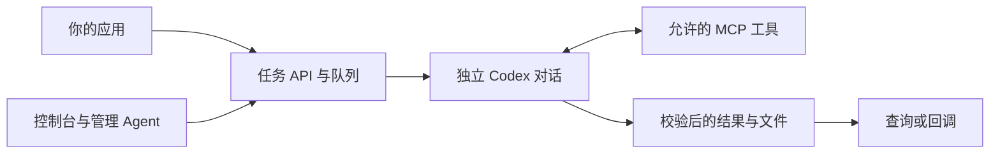

# Codex Agent Platform

系统配置分别设置业务和管理的全局默认模型与思考程度；管理对话只保留一个模型名称入口，点击后在同一面板选择模型，并通过分档滑块调节思考程度。可以点击档位或使用方向键、Home、End；拖动时预览，松手后保存。恢复默认会重新继承设置，“使用模型默认”保留为独立选择。长模型列表支持搜索；手机使用底部面板，并适配键盘可见区域。业务插件可在插件列表打开“配置接入 → 模型设置”，直接指定模型和思考程度，也可通过管理 Agent 配置；支持继承全局设置，已接单任务保留原配置。选项来自 Codex 返回的模型列表，思考档位随模型变化；无法获取的已有设置会保留显示。插件设置会随已接收任务保存；对话设置用于后续轮次。详见[模型与思考程度配置](docs/DEPLOYMENT.md#model-and-reasoning-selection)。

所有模型配置入口均支持“普通／快速”响应速度，首次使用和旧配置均默认普通。管理对话的快速开关位于思考程度区域内，模型名称与默认思考档位在列表中同一行显示。速度独立于思考程度；快速模式仅在模型目录明确支持时可选，并会增加额度消耗，实际可用性仍受账号限制。对话和插件可以继承全局速度，也可以在全局快速时单独选择普通模式。

**把需要反复交给 AI 的工作，变成你的系统可以直接调用的服务。** 提交任务，让 Codex Agent 自主完成，再按事先约定的格式取回结果。

[English](README.md) | [简体中文](README.zh-CN.md)

这个自托管平台面向开发者和受信任的小团队：你可以把内容审核、结构化报告、图文创作、定时处理等工作接入现有系统。平台负责排队、执行记录、文件保存和日常管理，你主要定义“输入什么、要完成什么、最后返回什么”。

**当前正式版本：v1.0.2。** Admin 控制台支持中英文：在登录页或页面右上角选择语言，浏览器会记住选择。切换时保留当前未保存的表单，不会翻译业务提示词或任务数据。README 也提供中英文版本。平台使用你自己的 ChatGPT 账户，通过 OpenAI 服务执行模型任务。本项目由社区独立开发，并非 OpenAI 官方产品。

## 目录

- [适合谁使用](#适合谁使用)
- [能做什么](#能做什么)
- [安装前需要准备什么](#安装前需要准备什么)
- [安装与 Codex 授权](#安装与-codex-授权)
- [提交第一个任务](#提交第一个任务)
- [添加自己的业务和定时任务](#添加自己的业务和定时任务)
- [日常使用建议](#日常使用建议)
- [修改平台系统提示词](#修改平台系统提示词)
- [安全风险与建议](#安全风险与建议)
- [常见问题](#常见问题)
- [开发与其他文档](#开发与其他文档)

## 适合谁使用

| 你想解决的问题 | 平台怎样帮助你 |
| --- | --- |
| 想让网站、后端或内部工具调用 AI 完成工作 | 通过带鉴权的 API 提交结构化参数，随后查询结果，或让平台回调你的系统。 |
| 同一类工作要反复做，不想每次手动新建聊天、粘贴要求、整理回复 | 把输入字段、完整要求和输出格式保存为插件；每次请求都独立执行。 |
| 需要知道 AI 服务运行得怎样、哪些任务失败了 | 在控制台或管理对话中查看任务和错误、暂停队列、调整参数，并明确选择要重试的任务。 |

例如，内容系统发送一篇文章和审核标准。Agent 完成审核后，返回“是否通过”和“判断依据”。你的系统直接使用 JSON 结果，不必再从一段聊天回复中提取字段。

当前版本适合一个运营者或共同信任的小团队：管理员共享管理权限，每个插件使用独立入口密钥，该密钥只能访问本插件的任务和产物。项目尚未提供独立客户账户、多租户隔离、细粒度角色权限和客户计费。需要向互不信任的用户提供服务时，应先建设相应的访问控制。

## 能做什么

- **把完整工作交给 Agent。** 正常执行时，平台向一个独立 Codex 对话发送一次完整任务。Agent 自行决定步骤、选择允许的工具，最后调用 `complete_task` 提交结果。
- **约定清楚输入和输出。** 插件声明输入字段、任务要求、可用能力和结果结构，服务按这些约定校验提交的数据。
- **保留任务记录与产物。** 查询任务状态、具体错误和执行信息；下载任务生成的图片与文本文件。
- **提供控制台和管理 Agent。** 管理插件、计划任务、队列和参数；调查失败原因，并按明确要求重试。
- **日常参数可以动态修改。** 模型、并发、暂停、队列容量、超时和管理提示词等配置会持久保存，普通修改无需重启。每个插件的入口和可选回调连接由人在控制台单独配置。管理回复实时显示在 Agent 气泡中，执行过程可折叠，断线后恢复内容；已结束的对话可在历史列表中确认删除。
- **重启后恢复未完成工作。** 保存的任务文件和 Codex 会话可用时，使用原任务、原线程继续；恢复时可能追加一条继续指令，已经完成或失败的任务不会自动重跑。



这里的 **Agent** 是负责执行工作的 AI，**MCP 工具**则是平台开放给它的具体操作，例如保存文件、提交结果。按照本教程使用，不需要另行搭建 MCP 客户端。

内置两个通用示例：`content.review` 负责文本审核，`novel.illustrated` 负责图文小说。已有工具支持保存文本、登记生成的图片，以及向预先配置的 HTTP 目标发送 JSON；原生生图和联网搜索是否可用，还取决于插件设置与账户能力。

**插件是一份配置。** 当已有工具能够满足需求时，新增业务不需要修改平台代码；若缺少数据库连接、特殊文件处理等底层能力，仍需开发相应工具。管理 Agent 可以配置和运营平台，不能修改源码、执行任意 Shell 或管理无关服务。

同样的 `request_id` 和参数再次提交，仍会创建新任务，平台不会据此去重。一次完整任务消息也不等于只计算一次模型；调用工具和内部协作时可能发生多次模型计算。请据此设计调用方重试和用量管理。

## 安装前需要准备什么

| 项目 | 具体要求 |
| --- | --- |
| 服务器 | 一台你可以管理的 Linux 主机。提供的部署方式已在 Linux x86_64 上验证。 |
| 主机工具 | Git、Bash、Docker Engine、Docker Compose v2、curl 7.76+；远程管理时还需要 SSH。可先运行 `docker version` 和 `docker compose version` 检查。 |
| 系统权限 | 可以操作 Docker，并创建私有运行目录。下面命令使用 `sudo`；如果当前用户已有相应权限，可以省略。 |
| 网络 | 构建时可以访问镜像与依赖仓库；运行时 Runner 和 Manager 容器可以通过 HTTPS 访问 Codex 所需的 OpenAI 服务；浏览器登录也需要联网。 |
| 账户 | 你自己的 ChatGPT 账户，具备 Codex 使用权限、足够用量，以及目标模型和工具权限；团队策略可能另有限制。 |
| 本地端口 | 默认使用主机回环地址的 `3004`（API）和 `3007`（Admin）；端口被占用时，在首次启动前改用其他端口。 |

Docker 镜像已经包含 Node.js、SQLite 支持和固定版本的 Codex CLI，**使用这套部署方式不需要在宿主机另装这些组件**。不需要本地 GPU，模型由 OpenAI 服务执行，因此也不能离线运行。

小规模试用可以从约 2 核 CPU、4 GB 内存、10 GB 可用磁盘起步。这是容量规划建议，不是经过测定的最低配置。构建缓存、图片、历史文件以及更高并发都需要额外空间和资源。

当前源码固定使用 Codex `0.159.2`，默认模型为 `gpt-6.1-sol`。写入模型名称不会自动获得其权限。账户支持范围和使用额度以 [OpenAI 当前说明](https://help.openai.com/en/articles/11369540-using-codex-with-your-chatgpt-plan)为准，不要把某种订阅理解为无限使用。

## 安装与 Codex 授权

下面的服务器命令都在克隆后的源码目录执行。源码与运行数据分开保存，本教程用 `/data/codex-agent-platform` 作为**运行目录**。

### 1. 获取代码并初始化私有配置

```bash
sudo git clone --branch v1.0.2 --depth 1 https://github.com/NM1024/codex-agent-platform.git /opt/codex-agent-platform
cd /opt/codex-agent-platform
sudo ./deploy.sh init /data/codex-agent-platform
```

`init` 会生成内部 `RUNNER_TOKEN`、独立的 Admin 初始密码，并创建持久化目录。这个步骤不会登录、构建镜像或调用模型；再次执行会保留已有配置和数据。

首次启动前，在服务器上私下检查 `/data/codex-agent-platform/.env`。打开控制台后，先配置插件的入口地址和入口密钥，再启用或提交任务；回调地址可以留空。不要把 `.env.example` 中的占位密钥直接用于部署。

### 2. 构建三个服务的镜像

```bash
sudo ./deploy.sh build /data/codex-agent-platform
```

这个步骤将锁定版本的依赖安装到镜像中。更新源码或依赖后需要重新构建；通过控制台调整普通运行参数不需要重新构建。

### 3. 允许设备码登录，再完成授权

先在 ChatGPT 的**设置 → 安全**中允许**设备码登录（device code login）**；部分界面可能显示“安全与登录”，具体名称随语言和界面版本变化。团队账户可能需要管理员在工作区权限中开放。可对照 [OpenAI 的无浏览器设备登录说明](https://developers.openai.com/codex/auth/#login-on-headless-devices)。

然后在服务器执行：

```bash
sudo ./deploy.sh login /data/codex-agent-platform
```

1. 保持终端打开，它会显示一个验证链接和临时代码。
2. 在自己电脑的浏览器打开终端给出的链接，登录准备使用的账户或工作区。
3. 输入**自己服务器终端里生成的代码**，确认是自己刚发起的登录后授权。
4. 等待服务器终端显示 `Successfully logged in`。

浏览器点完授权还不算最终检查，应以 CLI 完成登录为准。代码过期或页面提示 `invalid_auth_step` 时，取消当前登录，重新执行命令获取新代码。不要使用别人发来的登录代码，也不要在 Issue 中粘贴代码或登录文件。

登录状态保存在运行目录的 `codex/` 中，Runner 与 Manager 共用。授权有效且目录保留时，普通重启无需重复登录。本版使用 ChatGPT 登录，不支持以 API Key 登录替代。

**Agent 工具权限已经由项目配置。** 你不需要把 MCP 端口开放到公网，也不需要打开任意 Shell、文件编辑或其他无限制权限。图文示例已经声明要使用原生生图，但账户仍须具备相应能力。登录成功不代表所有模型和工具都可使用。

### 4. 启动并检查

```bash
sudo ./deploy.sh start /data/codex-agent-platform
sudo ./deploy.sh status /data/codex-agent-platform
curl -sS http://127.0.0.1:3004/healthz
curl -sS 'http://127.0.0.1:3004/readyz?type=content.review'
```

`start` 使用已经构建好的镜像。`/healthz` 应返回 `{"alive":true}`；准备完成时，`/readyz` 的结果包含 `"ready":true`。否则查看 `reason`，按[常见问题](#常见问题)排查。新插件需要先由人配置接入才能就绪。进程存活、账户准备完成、真实任务成功，是不同层次的检查。

### 5. 打开控制台并修改初始密码

在服务器上私下读取初始密码：

```bash
sudo cat /data/codex-agent-platform/manager/initial-password
```

在**自己电脑**上建立 SSH 隧道，并保持窗口打开：

```bash
ssh -N -L 3007:127.0.0.1:3007 user@your-server
```

把 `user@your-server` 换成自己的 SSH 登录地址，然后在电脑浏览器访问 [http://127.0.0.1:3007/admin/](http://127.0.0.1:3007/admin/)。若服务器本身有浏览器，也可以直接访问这个地址。用初始密码登录，在**系统配置 → 安全与登录 → Admin 密码**中填写当前密码和新密码。验证成功后所有网页会话退出；当前密码错误不会退出登录。初始密码文件不会覆盖已经保存在 Manager 数据库中的新密码。

公网域名、HTTPS 证书和外部访问网关，由部署者使用自己的基础设施配置。本教程采用私有 SSH 访问。内部服务端口应保持私有；对接已有网关时需要保留的请求信息见[部署文档](docs/DEPLOYMENT.md#https-and-remote-console-access)。

## 提交第一个任务

从这里开始会真实调用模型，使用你的账户额度。建议先运行一条短文本任务，确认完整链路正常，再测试生图和增加并发。

### 1. 提交任务

在控制台打开**业务插件 → content.review → 配置接入**。保留默认 `/hooks/content/review` 路径，或填写使用 `/hooks/...` 路径的公网 HTTP(S) 地址。生成入口密钥，保存前将其复制到调用方的私有配置中；平台不会再次显示保存后的密钥。保存连接后，再单独启用插件。入口配置缺失时，API 提交、试运行和定时任务均不能执行；管理 Agent 无权代填这些字段。

在**服务器的 Bash 终端**运行以下命令，只在隐藏输入提示处粘贴该插件的入口密钥：

```bash
read -r -s -p 'Plugin entry key: ' PLUGIN_ENTRY_KEY; printf '\n'
curl --fail-with-body -sS http://127.0.0.1:3004/v2/tasks \
  -H "Authorization: Bearer $PLUGIN_ENTRY_KEY" \
  -H 'Content-Type: application/json' \
  -d '{"type":"content.review","request_id":"review-demo-1","input":{"content":"我们的客服会在一分钟内回复每一条消息。","criteria":"识别需要证据支持的说法，并解释审核结论。"}}'
```

HTTP `202` 只表示已经接单。复制响应中的 `task_id`，用它查询任务。

### 2. 查询结果

在同一个终端，把下面占位值换成刚返回的任务编号：

```bash
TASK_ID='replace-with-returned-task-id'
curl --fail-with-body -sS "http://127.0.0.1:3004/v2/tasks/$TASK_ID" \
  -H "Authorization: Bearer $PLUGIN_ENTRY_KEY"
unset PLUGIN_ENTRY_KEY TASK_ID
```

任务还在排队或执行时，可以再次查询；不要为了查看进度重新发送 POST。控制台的**任务记录**中也能查看同一个任务及其详情。

| 状态 | 表示什么 |
| --- | --- |
| `queued` | 已接单，等待并发空位、执行条件或恢复调度。 |
| `dispatching` / `running` | 正在启动或执行 Agent 对话。 |
| `completing` | 正在校验并保存 Agent 提交的结果。 |
| `suspended` | 未完成的执行等待核对状态或继续。 |
| `completed` | 结果已经被接受，具体业务是否成功要看结果字段。 |
| `failed` | 本次执行失败，先查看错误，再决定是否重试。 |

文本审核结果包含 `approved` 和 `reasons`，例如 `{"approved":false,"reasons":["一分钟内回复每条消息的承诺需要证据支持。"]}`。审核不通过是一个有效业务结论，不等于平台执行失败。

### 3. 再试其他能力

- 生图示例：先为 `novel.illustrated` 配置独立入口密钥并启用，检查 `/readyz?type=novel.illustrated`，再使用它自己的密钥提交该类型，输入可以是 `{"premise":"灯塔守望人收到一封来自明天的信。","chapters":1}`。实际执行仍可能遇到账户或模型限制；生图通常比短文本任务耗时更长、用量更多。
- 下载文件：带 API 鉴权访问 `GET /v2/tasks/{task_id}/artifacts/{artifact_id}`，或在控制台打开对应产物。
- 接收回调：在该插件的**配置接入**窗口填写回调地址，以及接收方要求的可选 Bearer 凭证。最终回调包含结果和文件元数据，不直接附带图片文件；详见[插件与交付](docs/PLUGINS.md#result-and-delivery)。

## 添加自己的业务和定时任务

**业务插件**页面展示定义、状态、模型和思考程度，并提供启用／停用开关。如需新增、编辑或试运行，请在**管理对话**中让管理 Agent 操作，写清输入字段、完整任务要求、结果格式和允许使用的工具。创建后，由人在对应行的**配置接入**窗口填写入口地址、入口密钥和可选回调。入口路径及密钥必须唯一，业务定义编辑不会覆盖连接配置；保存连接不会自动启用插件。可以从内置示例开始，不要把密钥写进提示词或业务输入。

也可以在**管理对话**中提出具体要求，例如：

> 新增一个文本摘要插件，接收 `text`，返回 `summary` 和 `key_points`。不使用生图，也不调用外部 HTTP。先保存配置，告诉我请求格式，暂时不要试运行。

管理 Agent 能组合已有能力；缺少底层工具时，需要开发补充。将新插件接入真实系统前，应检查保存的配置，并完成一次试运行。已经接收的任务会保留接单时的插件要求和结果约定；后续编辑影响新请求。

**定时计划**页面展示计划、规则、时区和详情，并提供启用／停用开关。创建和编辑请通过管理 Agent，说明业务任务或巡检要求、频率和时区，例如 `0 9 * * *` 表示在所选时区每天 09:00 运行。先使用低频计划，核对下一次执行时间；暂时不用的计划应停用。开启的计划会在你离线时继续触发，也会消耗账户额度。

运行概览用独立卡片展示宿主 CPU／内存、数据磁盘、Manager 容器 CPU／内存和进程 RSS；容量显示已用／总量及可用空间。任务领取、并发上限、服务就绪状态分开展示。页面自动刷新，并保留正在编辑的并发值。

手机端顶部保留平台标题，项目仓库、语言切换和退出使用图标按钮；点击菜单按钮可展开全部六个页面入口。对话输入区的模型入口、图片和发送操作保持在一行，模型与思考程度在同一底部面板选择，并随键盘可见区域调整布局。

管理对话会显示每条消息的排队、执行、等待恢复与结束状态。同一对话按顺序处理，Agent 执行期间仍可发送后续消息排队。默认折叠的执行记录展示可用的推理摘要、Agent 进度和工具调用状态；上游没有提供摘要时不会编造思考过程。回复支持复制完整 Markdown，代码块可单独复制。

待发消息只显示在输入框上方的队列条目中，开始处理后才进入对话区。“撤回编辑”会暂停这条消息并展开编辑，保留原附件，也不覆盖输入框里的草稿；“重新排队”会把修改后的消息放到队尾。“删除”移除尚未开始的消息及其图片。“立即引导”会把该条消息交给正在工作的原生 Codex 轮次，让 Agent 调整当前任务，不新开一轮，也不打断任务。已经开始执行的消息不能撤回或删除。连接异常导致引导发送结果无法确认时，会明确显示状态待确认，不会自动重发；任务结束或恢复时会核对原生输入记录。

对话支持选择、粘贴或拖入 JPEG、PNG、WebP 图片，发送前可预览和移除。每条消息最多四张；浏览器将图片压缩到最长边不超过 2048 像素、每张不超过 160 KiB，以适配默认 1 MiB 请求限制。原图超过 20 MiB 或 4000 万像素时请先缩小。图片随对应消息保存在 Manager 的私有数据中，并会作为该次模型输入发送；不要上传无权处理的资料。

后台保留启用／停用、暂停／恢复、模型、思考程度、并发和密码等直接操作。业务 JSON 和管理提示词等复杂配置通过管理 Agent 修改。插件连接仅允许人在对应窗口配置；普通 HTTP 工具的具名目标由部署环境配置。

## 日常使用建议

管理对话可以直接请求生成图片，无需创建业务插件；实际可用性仍取决于账号和模型权限。生成图片随对话私密保存，可预览和下载。点击上传或生成的聊天图片，可在当前页面内缩放、旋转和切换同条消息中的图片，点击关闭按钮或按 Escape 退出；下载入口独立保留。新回复会平滑逐字显示，重新打开历史时直接展示已有文字。侧栏每批加载 30 个对话；对话默认展示最近 20 组用户消息与回复，必要时额外保留较早的运行中消息，避免错过待回答的提问。点击“加载更多对话”或“加载更早消息”可以继续查看历史。

旧管理对话每轮都会加载当前部署的平台规则及内容版本；可让 Agent 调用 `platform_context` 重新核对，通过 `project_source` 列出、搜索和阅读管理端源码、Admin 前端、提示词与文档。该工具仅限指定源码范围，只读，不读取凭证或运行数据。更新代码后需重新构建并部署 Manager，它读取的是运行镜像中的版本。

管理 Agent 已启用 Codex 原生实时联网搜索和公开网页读取。可以直接让它查资料或阅读公开链接，它会按需调用工具并附上来源链接。实际检索由 Codex 上游托管工具处理，无需额外搜索 API 密钥或自建爬虫，也不扩大本机命令和网络权限。可用性仍取决于账号、模型及目标网站；不提供登录态浏览或内网访问。网页内容不能授权管理操作。

- **先小规模验证。** 新安装默认在所有业务插件之间共用 `5` 个业务任务并发。升级保留显式配置和已保存值；已有部署可在“系统配置 → 业务执行 → 并发”修改。谨慎试用时可以先选 `1`，确认耗时、账户限制和磁盘使用后再增加。一次请求包含多个条目时，仍对应一个根对话，Agent 可以使用允许的内部协作能力。
- **维护前先暂停领取。** 暂停后，新接收的请求进入队列，正在运行的任务继续。重启前查看活跃任务，保留执行文件和登录状态，恢复依赖后让未完成对话继续。
- **普通参数在控制台或管理 MCP 修改。** 保存值优先于首次启动的 `.env` 默认值。正在执行的任务保留启动时的参数；后续执行使用新的模型和超时。端口、挂载、运行路径及内部凭证需要调整部署。
- **把重试看成一次新工作。** 显式重试会创建有关联的新任务，保留旧记录；模型调用和外部副作用可能再次发生。交付结果为 `unknown` 时，先调查，再决定是否重试。
- **做备份，也看磁盘。** 数据库、对话文件和图片默认持续保存，可按需开启历史数据清理。本版本没有全局费用硬上限。可在服务停止时一致地备份整个运行目录，并像保护在线数据一样保护备份。

以下命令在源码目录执行：

```bash
sudo ./deploy.sh status /data/codex-agent-platform
sudo ./deploy.sh logs /data/codex-agent-platform
sudo ./deploy.sh stop /data/codex-agent-platform
```

### 更新到最新正式版本

已有安装首次接入更新器（Linux，需 Python 3.10+、curl 和 Docker Compose v2）：

```bash
curl -fL https://github.com/NM1024/codex-agent-platform/releases/latest/download/update.sh -o /tmp/codex-platform-update.sh
sudo bash /tmp/codex-platform-update.sh update
```

脚本会识别现有标准 Compose 安装的项目名和运行目录，支持 Git 克隆和源码包安装。有多个实例时，在 `update` 后追加原运行目录。自定义 Compose 覆盖文件需要手动升级；无法可靠识别时会停止并提示。

首次成功后，日常执行：

```bash
sudo bash /data/codex-agent-platform/deploy.sh update
sudo bash /data/codex-agent-platform/deploy.sh status
sudo bash /data/codex-agent-platform/deploy.sh logs
```

将路径换成你的实际运行目录。只选择 GitHub 最新已发布的正式 Release，校验版本包的 SHA-256，不跟随 `main`、草稿或预发布版本。先下载并构建镜像，再停服并一致备份运行数据（停服时长取决于数据量），重启并检查健康状态。保留 `.env`、账户授权和历史数据，不改原来的 Git 工作区。

备份含有密钥与授权文件，必须私密保存；磁盘需为备份和镜像构建预留空间。健康检查失败会报告备份位置，不会自动降级已迁移的数据库。详见[更新与恢复说明](docs/DEPLOYMENT.md#stable-release-updates)。

### 顶栏版本信息与网页升级

顶栏显示当前 Manager 镜像的实际版本。点击后可检查最新正式 Release、查看发布说明或复制服务器更新命令；检查版本不会执行模型任务或升级。

标准 Linux/systemd 部署以 root 启动时会自动安装并启用宿主机更新服务；从旧版升级时也会自动补装，不再需要单独执行安装命令。可用以下命令检查状态：

```bash
sudo ./deploy.sh web-update-status /data/codex-agent-platform
```

上述命令在源码目录执行，并指定实际运行目录；首次成功更新后才会生成运行目录中的 `deploy.sh` 入口，之后也可使用该入口。源码、运行目录及 `.env` 的路径层级须由 root 持有且不能被其他用户修改，因此首次安装示例将源码放在 `/opt`。已有普通用户工作区可先以 root 执行命令行正式版更新，让脚本生成可信源码。没有运行中的 systemd、非 root 部署或自动配置失败时会明确提示，命令行更新仍可使用；解决提示的问题后，可执行 `sudo ./deploy.sh enable-web-update /data/codex-agent-platform` 重试配置。

有新版且宿主机服务可用时，版本窗口才启用升级按钮。确认停服后，由宿主机服务执行下载校验、构建、备份和健康重启，网页会跟踪同一个持久任务并在 Manager 重启后重连。Manager 和管理 Agent 不会获得 Docker socket 或任意宿主机命令权限；不安装服务也能正常使用平台。

```bash
sudo ./deploy.sh disable-web-update /data/codex-agent-platform
```

关闭选择会持久保存，后续启动和升级不会重新开启；`enable-web-update` 可恢复启用，旧版已经禁用的 systemd 服务也会保留关闭状态。首次 `init` 后即可提前关闭。升级途中停用服务会中断任务，可能需要恢复；恢复备份前请先阅读[部署与恢复说明](docs/DEPLOYMENT.md#host-service-for-browser-upgrades)。

### 自动清理到期历史数据

在**系统配置 → 历史数据清理**设置开关和保留天数，支持 30 天、60 天或自定义天数。默认关闭，保存后持久生效。开启后每天分批永久删除到期的管理对话、已结束任务记录及相关图片和文件；对话按最后活动时间、任务按结束时间计算。未结束的工作、插件、定时计划定义和账号配置会保留。开启或缩短期限也会清理已有到期数据，不做归档；详见[清理范围与生效规则](docs/DEPLOYMENT.md#automatic-history-cleanup)。

### 管理对话的内存控制

管理对话默认同时执行 **2** 轮，可在**系统配置 → 管理 Agent → 管理并发数**调整为 1–5，与业务任务并发相互独立。其余对话在数据库中排队；普通续聊不再向管理服务返回整段历史。完整记录和模型原有上下文压缩策略保留，详见[内存控制与测量说明](docs/MEMORY.md)。

## 修改平台系统提示词

平台内置的系统指令和固定消息模板统一放在 [`prompts/`](prompts/README.md)。目录说明列出了每个文件的用途、占位符和生效方式；文件是普通 Markdown，每份只保留一个版本。其他语言的用户可以直接翻译、调整文字，不用到程序代码中查找，也不需要维护中英文两套提示词。Admin 的界面语言切换不会改动它们。

已有部署的管理 Agent 提示词，请让管理 Agent 通过 `configuration_update` 修改 `manager` 范围的 `instructions`；系统配置页面可查看当前值，保存后下一轮生效，无需重启。`prompts/manager.md` 是首次安装的默认值；数据库中已保存的提示词优先，包括安装时自动保存的初始值。修改其他内置模板（任务初始消息、重启恢复、任务调查）后，需要重新构建镜像并部署。具体见[提示词修改说明](prompts/README.md#editing-and-applying-changes)。

在“业务插件”列表点击“对接文档”，可查看该插件的请求字段、结果结构、异步任务协议、查询与产物下载接口、回调约定和示例，并复制或下载 Markdown。文档随已保存配置生成，不包含接入凭证。业务字段缺少含义时，可让管理 Agent 在 Schema 中补充 `description` 和可校验的 `examples`。

每次管理对话启动或恢复时，还会附加随版本更新的项目运营规范和人工接入规则，已有自定义提示词也能收到更新。这些规范涵盖任务生命周期、能力约定、模型继承、定时计划和部署边界。管理 Agent 通过工具查询当前设置和 schema，不会自动读取仓库 README；以后修改平台行为时，需要同步更新这份固定规范和工具说明。

业务插件的 `instructions` 仍属于插件配置，由用户或管理 Agent 通过插件工具创建、修改；它们与平台系统提示词分开维护。

## 安全风险与建议

**把它作为只供可信人员使用的高权限服务部署。** Agent 会在允许的工具范围内自动执行操作，通常不会每一步都请人确认。Admin 权限能够修改插件和计划、提交工作、更改凭证，并请求服务重启。

| 风险 | 建议怎么处理 |
| --- | --- |
| 任务数据会离开服务器 | 提示词、相关输入和工具结果会发送给 OpenAI；配置的 HTTP 目标会收到向其发送的数据。确认适用的账户或工作区数据政策，只提交有权处理的数据。平台自托管不等于模型在本地处理。 |
| 登录状态泄露可能被复用 | 把 `codex/`、`.env`、数据库和备份作为敏感资料保护，限制文件访问，做好账户 MFA。不要公开 `auth.json`，也不要粘贴到聊天或 Issue。 |
| API 密钥或 Admin 密码泄露可被用于操作平台 | 修改初始 Admin 密码，不向不可信用户共享账户或密钥。管理优先使用 SSH 隧道或 VPN；必须开放公网时，增加可信 HTTPS、访问限制和代理侧登录/API 限速。应用本身没有提供完整的登录防滥用机制。 |
| 恶意内容可能诱导 Agent 错用工具 | 把任务输入、插件提示词和外部回复当作不可信内容。每个插件只启用必要工具；只配置可信 HTTP 目标，使用范围有限的凭证。HTTP 工具可以选择已配置的目标，必要时再用网络出口规则约束访问。 |
| 自动执行会消耗额度，重试可能重复外部操作 | 从并发 `1`、少量任务和少量计划开始，监控账户用量。先调查再重试；网络结果不明确的最终回调不会自动重发，也无法保证远端副作用恰好发生一次。 |
| AI 输出可能出错 | 结果结构通过校验，不代表事实、图片质量或业务合规性一定正确。把审核规则写清楚，重要操作前安排人工复核。 |

容器使用非 root 用户、只读根文件系统，不挂载 Docker Socket；工具策略限制任意 Shell、文件编辑和无关工具。这些措施提供了边界，不等于已经完成安全审计，也不能当作恶意租户之间的强隔离。服务器管理员和 Docker 操作者仍属于可信人员。

Admin 密码、各插件入口密钥、回调接收方凭证、内部 `RUNNER_TOKEN` 和 ChatGPT 登录是不同凭证，修改其中一个不会撤销其他凭证。入口密钥以哈希保存；回调凭证私有存储，控制台只允许写入。敏感值应填写到专用的私有配置字段，不要贴进管理对话，因为聊天与任务记录会持久保存。发生泄露时，撤销或轮换受影响的凭证，并调查使用情况。漏洞反馈方式见 [SECURITY.md](SECURITY.md)。

## 常见问题

| 现象 | 优先检查什么 |
| --- | --- |
| 登录命令还没显示设备码就失败 | 检查 **Runner 容器内部**的 HTTPS 连通性和可信 CA，再检查账户或工作区是否允许设备码登录。宿主机能 `ping` 通不代表登录请求可用，不要通过关闭 TLS 校验解决。 |
| `invalid_auth_step` 或代码过期 | 停止当前登录，重新生成代码，在新的浏览器会话中使用终端给出的链接；确认使用的是准备授权的账户或工作区。 |
| `CHATGPT_LOGIN_REQUIRED` | 再次执行登录命令，确认使用同一个运行目录；不要分享或手工修改登录令牌。 |
| `RATE_LIMITED` 或模型/工具无权限 | 检查账户用量、团队限制和模型权限；降低并发，或在系统配置中使用自己有权访问的模型。准备检查通过不代表所有模型都能使用。 |
| 生图准备检查不通过 | 检查插件的原生生图开关与账户能力，可以先单独验证文本任务；项目没有其他生图供应商回退。 |
| 任务一直 `queued` | 在控制台检查是否暂停、Runner 是否就绪、当前活跃任务与并发数；反复发送 POST 会增加任务。 |
| 工具提示需要审批 | 检查是否使用本项目固定的构建版本和随附 MCP 配置。账户登录与工具审批不是一回事，不要通过开放无限制权限来绕过问题。 |
| `RESULT_NOT_SUBMITTED` | Agent 轮次结束时没有成功提交 `complete_task` 结果。查看最后回复、工具错误和插件要求，再决定是否重试。 |
| 任务完成了，但回调失败或为 `unknown` | 查看交付详情和接收端记录；执行与交付分开记录，HTTP 2xx 也只证明对方接口接收，不证明后续存储成功。 |
| 改了 `.env` 没效果 | 日常配置已经被持久保存，应在系统配置中修改；端口等部署引导项仍需重新创建相应容器。 |
| `/data` 下出现权限不足 | 确认容器 UID/GID `1000:1000` 能访问挂载目录；root 初始化会为新建目录分配权限，不要把整个运行目录改成所有人可写。 |

账户和协议探测命令见[部署文档](docs/DEPLOYMENT.md#health-and-diagnostics)，探测不会启动模型轮次；真实任务和管理对话会使用模型。

## 开发与其他文档

开发源码时，在本机安装 Node.js **24**，然后运行：

```bash
npm ci --ignore-scripts
npm test
npm run check:release
```

管理前端已完整使用 React、TypeScript 和 Ant Design，仅提供一个生产构建，不保留旧前端回退。验证覆盖 203 项平台及部署检查和 32 项浏览器检查，包括中英文、桌面及手机布局、模型选择和 CSP。CI 构建全部四个发布目标。检查均使用合成数据和模拟 Codex 传输；具体执行方式及 Docker 环境限制详见[验证范围](docs/VALIDATION.md#model-settings-and-react-admin-migration)。

| 文档 | 内容 |
| --- | --- |
| [架构](docs/ARCHITECTURE.md) | 组件职责、任务生命周期和信任边界。 |
| [系统提示词](prompts/README.md) | 内置指令的存放位置、修改方法与生效方式。 |
| [插件](docs/PLUGINS.md) | JSON 定义、能力、路由、文件和回调。 |
| [部署](docs/DEPLOYMENT.md) | 持久化目录、HTTPS、探测、密码恢复与备份。 |
| [参与贡献](CONTRIBUTING.md) | 开发和提交变更的要求。 |
| [安全](SECURITY.md) | 漏洞反馈和部署注意事项。 |

项目源码采用 [MIT 许可证](LICENSE)，第三方依赖遵循[各自许可证](THIRD_PARTY_NOTICES.md)，OpenAI 服务使用适用的服务条款。软件开源不意味着自动获得模型权限或无限额度。

管理对话会分别保留公开的中间回复和最终结果。Agent 使用原生提问时，可在卡片中选择选项或补充回答，提交后继续原来的轮次，不会新建业务任务。切换聊天或页面会保留本次会话中的回答草稿；轮次结束、超时或中断后，未回答的卡片失效。等待回答仍计入配置的执行超时。密钥、密码请始终在专用配置页填写。

管理对话在输入框上方固定显示当前任务阶段、耗时和距最近进展的时间，Agent 回复旁也有同步状态。生成图片、网页搜索、输出回复、等待回答、等待继续、完成和失败均使用实际记录；重连或读取失败时明确提示状态可能延迟，未核对的旧任务不会覆盖最新结果。用户消息上方仅显示浏览器本地日期和时间。动画保持固定尺寸并遵循减少动态效果偏好。
