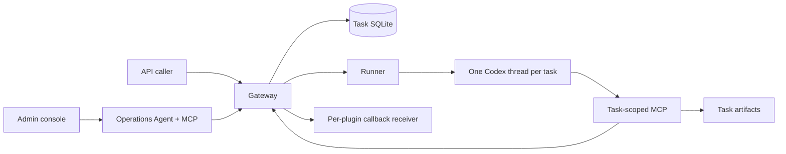

# Architecture

## Responsibilities

| Module | Responsibility |
| --- | --- |
| `application.mjs` | Assemble generic capabilities, example plugins and configuration scopes. |
| `core/` | Request/run identity, queue, dispatch, durable lifecycle, operations and completion receipts. |
| `prompts/` (repository root), `src/prompts.mjs` | Platform-owned system instructions and fixed task/management message templates; plugin instructions remain plugin configuration. |
| `plugins/` | Validate and store JSON contracts; construct complete task messages and permitted capabilities. |
| `capabilities/` | Task-owned image/text artifacts and requests to named HTTP destinations. |
| `delivery/` | Configured final-result delivery, independent of Agent execution status. |
| `runtime/`, `codex/` | App-server transport, per-run workspaces, tool policy, lifecycle events and resumption. |
| `configuration/` | Persistent module-owned settings with write-only credentials and application hooks. |
| `operations/` | Preset task/plugin/configuration operations and persistent cron plans. |
| `manager/` | Independent management conversation, MCP adapter, Admin authentication and web console. |
| `frontend/` | React + TypeScript + Ant Design Admin source. Vite bundles it into generated `src/manager/web-dist/`; Manager serves only those production assets. |
| `contracts/`, `observability/` | Shared management schemas and bounded resource measurements. |

Admin pages load on demand. The build generates Brotli and gzip variants of every hashed JS/CSS resource; Manager negotiates `Accept-Encoding` and returns `Vary: Accept-Encoding` with immutable caching. Nonce HTML and authenticated API responses are not compressed by this path. Release validation requires the complete manifest graph and both compressed variants, including deferred pages.

The Manager accesses Gateway operations through an internal API authenticated only by `RUNNER_TOKEN`. Its operations client does not use a public plugin entry key. It does not import the task runtime or query an external business database. Both management and task Agents use preset MCP tools plus their explicitly permitted native Codex capabilities; arbitrary shell, code editing and foreign MCP tools are denied.

## Lifecycle

Every accepted API request has a fresh `task_id`. Its execution uses one `run_id` and one root Codex thread. Agent-internal collaboration is permitted, but the platform does not split a business request into multiple root conversations or drive business steps message by message.

Normal execution sends one initial message. `complete_task` validates the plugin's result schema and task artifact ownership, then records completion. A task can fail if the Codex turn ends without submission, the runtime reports failure or its configured timeout expires. A failed business outcome can also be represented inside a successfully submitted result; execution status alone does not count business successes.

During restart, incomplete work is suspended, its files and known thread identifiers persist, and the dispatcher resumes it under the configured concurrency. A resumed task receives an extra continuation turn in its existing thread. Lost or unusable thread state cannot guarantee successful continuation. Completed/failed tasks require an explicit new request or retry to run again.

Accepted plugin contracts are stored with each request; editing or disabling a plugin affects new requests. Missing human connection configuration blocks admission, trials, schedules and queued/recovered launches. Execution settings are selected per launch/resumption segment; current work keeps its model/timeout snapshot. Per-plugin entry credentials change immediately. Pending callbacks resolve the current human callback configuration; ordinary HTTP capability calls resolve the current live named targets.

Plugins and schedules support logical deletion through explicit management operations and confirmed Admin actions. Nullable deleted_at columns migrate existing databases; active lists and startup registration exclude tombstones, and default plugin seeding never resurrects them. Deleted IDs/types and entry paths remain reserved; save/enable/connection mutation cannot restore them. Deleting a plugin atomically disables its task schedules with PLUGIN_DELETED and blocks new submissions/retries while preserving accepted task snapshots, completion, callbacks, historical queries and artifact access with the existing scoped key. Deleting a schedule stops future triggers and cancels queued inspections not yet claimed by Manager; past trigger records and already accepted tasks/conversations remain. Manager atomically claims each inspection in Gateway before creating local work, so a stale list cannot revive cancelled inspections. Claimed rows remain discoverable after lost responses/restarts, and local source IDs deduplicate intake before acknowledgement. Repeated deletion is idempotent. This is retention, not physical erasure, credential revocation or a recovery UI.

## Persistence and trust

Admin offers simple enable/disable controls for plugins and schedules, plus scalar/model/password settings. Plugin/plan definitions and management instructions are changed through the management Agent. Each plugin row's Configure connection modal is available only to a human's authenticated browser session; a dedicated internal Gateway endpoint persists its values and is absent from Agent tool contracts. Agents can read entry addresses and readiness and request backend initialization of missing entry keys through plugin_connection_initialize, without specifying or receiving credentials. Initialization preserves existing keys and human configuration. Humans must claim generated keys once in Configure connection; pending keys cannot authenticate or enable/execute work. Claim/replacement/callback endpoints remain browser-only and outside Agent tool contracts. Saving a connection does not enable a plugin. The connection modal separates retained entry/callback tabs, uses one entry-secret display/edit area and opens integration documentation without discarding drafts. Invalid fields select their own tab; disabling callbacks only deletes saved callback settings after Save. Task, plugin, schedule and overview lists use the available desktop content width with independent identity, status, connection and scheduling columns. Long identifiers have bounded text and a separate full-value copy control. Expanded tables switch to labelled records in containers at most 1050px wide, retaining fields and actions; settings forms and chat retain their own width limits. Named HTTP capability targets use the separate persistent http_targets scope, editable through Admin and preset management configuration operations. It is initialized from PLATFORM_HTTP_TARGETS_JSON only once; retired configuration:http records remain ignored. Writes require the current revision and use a conditional database update. Tokens are write-only, omitted tokens are retained, and an empty string clears one. Targets apply to the next HTTP tool call without restart, independently of plugin entry/callback configuration; saving performs no HTTP request. Management replies use React Markdown with GFM, escaped raw HTML and links in place of external images. Message timestamps retain UTC epoch storage and use the browser's local locale/time zone for display. Author, timestamp and Replying share one line; constrained screens shorten the timestamp visually while its title retains the full local value. Codex thread names synchronize through response metadata and name notifications; an optional one-second metadata read follows durable successful completion. Missing names preserve the existing title, with no extra generation turn.

Gateway owns `tasks.sqlite`; Manager owns `manager.sqlite`. Runner owns isolated work directories, Codex session state and artifacts. Gateway reads artifacts through a read-only workspace mount. Neither service has a Docker socket. Internal ports are not published; public ports bind loopback by default.

Admin uses its own password hash and expiring hashed cookie sessions. Every remote password update, including the management operation, requires the current password; a version-conditional update prevents concurrent verification against an outdated hash. Failure preserves sessions and success revokes all sessions. Trusted local recovery over stdin remains separate. Gateway keeps each plugin's unique entry path/key and optional callback URL/token in a private SQLite connection table, separate from business JSON and task snapshots. Entry keys are hashed for authentication. A generated key awaiting its one-time human claim also has a temporary plaintext copy in the private connection table; claim atomically removes that copy, increments revision and activates the hash. Manual replacement also clears any pending copy. Concurrent claims disclose once; an ambiguous lost response requires a human replacement if the key was consumed. Callback tokens stay private and write-only. Ordinary metadata reads expose only configured/claimable flags; only the dedicated authenticated same-origin human claim response discloses a key, with no-store caching. Runtime database files and backups therefore remain sensitive, including SQLite free pages after logical deletion. Public authentication binds the key to one plugin for submission, task queries and artifact downloads. Entry addresses may be absolute HTTP(S) URLs or `/hooks/...` paths; human changes survive Agent edits. Deployments must protect runtime volumes and backups.

The Admin shell bounds scrolling to each workspace. Chat has a desktop conversation sidebar/mobile drawer, separate user and Agent bubbles, a scrolling transcript and a persistent composer with compact model/effort controls. Existing conversation selections save automatically in request order; new conversations apply selections when sending. Configuration categories use separate tabs with retained drafts and aligned label/input rows; password changes live in the security tab. The header uses the project name and repository/language/logout icons without a manual refresh action; live views retain their own updates, and navigating to other views reloads their data. Copy/export and chat composer icons retain accessible labels, tooltips and local busy/error feedback.

Per-plugin integration documentation is a human-only Manager projection. It combines the current definition with whitelisted connection metadata into localized Markdown sections; JSON Schema annotations describe business fields while fixed transport rules match the task and callback APIs. Examples are schema-validated or explicitly unavailable, and complete schemas accompany bounded field summaries. No account work, trial or new Agent permission is involved. The Admin drawer provides safe Markdown/code copy and export with plugin/locale request guards; relative paths retain a Gateway host placeholder, credentials and actual callback URLs are excluded. Protocol documentation and tests must evolve with API changes.

Management messages remain a durable FIFO within each conversation. Each user message owns its execution timestamps, activity records and eventual reply; queued messages wait for the preceding turn. Public reasoning summaries, assistant output and tool lifecycle metadata are projected from the pinned Codex protocol. A cookie-authenticated SSE endpoint sends an initial durable snapshot and coalesced changed-message/metadata patches; reconnects read a fresh snapshot without resubmitting work. Live assistant text has a separate bounded projection (up to 1,048,576 UTF-16 code units), independent of the smaller activity budget. Chinese text can stream without whitespace; credential-like ASCII suffixes wait for a safe boundary. Final replies remain independent of these live limits. Public assistant items are persisted separately from activity, with a per-message budget of 100 items / 1,048,576 UTF-16 code units. Each gets a stable bubble; deltas update their own item and the final record does not erase earlier public output or duplicate the final item. The final reply record remains independent of this bounded live history. Interruption flushes the latest partial item, while unavailable streams fall back to polling. Raw reasoning, tool arguments and tool results are excluded. A collapsed timeline sits below its associated assistant bubble and shows reasoning summaries, tool calls and status records. Assistant-message activity supports compatible live-reply reconstruction but is excluded from the timeline to avoid repeating the reply; an assistant-only record leaves no empty timeline. Explicit queued/running/recovering/completed/failed states remain visible; absence of new activity does not imply completion. Open streams recheck sessions before updates and on 15-second heartbeats, disconnect slow clients and close during shutdown.

Humans can delete management history through authenticated, same-origin Admin DELETE requests. Pending queued/running/interrupted messages and still-finishing Agent processes block deletion. One transaction removes local conversation/message/image/activity/action records, followed by scoped local work/thread-directory cleanup that does not follow the shared login symlink. Cleanup failure is reported explicitly. Business tasks/results and the shared account authorization remain separate. Deleting local history is not a remote provider deletion request, and the platform does not claim secure erasure of SQLite free pages or filesystem backups.

Chat image attachments are private Manager data. The frontend rasterizes supported images, bounds dimensions and compresses them before sending within the existing 1 MiB HTTP envelope. Backend validation independently checks decoded image format, dimensions and size. Conversation responses contain attachment metadata and authenticated preview URLs; they do not repeatedly embed image data. The Agent's initial turn receives the stored images together with the message text. Attachment ownership follows the conversation, persists across queued/recovered messages and does not add another model turn.

`callback_once` records the attempt before sending. A transport failure can leave delivery `unknown`; the platform does not promise exactly-once remote effects or automatically replay an ambiguous callback. An HTTP acceptance response does not prove downstream storage succeeded.

## Platform prompts

Manager enables native live web search (`native.webSearch: true`, `web_search: "live"`) on both thread start and resume alongside image generation. Existing native web tools handle search, page opening and in-page lookup upstream; Manager adds no crawler, HTTP proxy or search credentials. Shell, patch, browser-use and arbitrary filesystem tools remain disabled in the read-only sandbox. The versioned project prompt requires actual source links, honest unavailable-page reporting, and treats web content as untrusted data that cannot authorize management operations. Existing public tool-lifecycle projections show web activity without exposing raw tool arguments/results. Account/model availability and website restrictions still apply; this is not authenticated or private-network browsing.

Manager enables native image generation alongside its preset operations and clarification. Completed image-generation items from the active thread/turn are ingested through `manager/generated-images.mjs`, independently of business artifacts. Only bounded, decoded PNG/JPEG/WebP files beneath the conversation work directory or its Codex `generated_images/` directory are accepted; symlinks and unrelated paths are rejected. Media writes drain before message completion. A unique message/item identity makes recovery ingestion idempotent. Private image bytes and preview/download metadata persist in `manager_generated_images` and use the existing authenticated conversation-image endpoint. History deletion also removes these images. Shell, source editing and arbitrary filesystem tools remain disabled.

Browser history is bounded separately from runtime bookkeeping. Conversation lists return `{items,next_cursor}` (30 by default, maximum 100), ordered by updated time and ID with a keyset cursor. Conversation reads and SSE snapshots return the newest 20 request/reply groups (maximum 100) with `history.has_more` and a conversation-owned `history.before` cursor. Replies remain with their request even if newer requests were queued first. Page actions and SSE action projections are bounded to 100 rows. Earlier-history requests do not start model work. The browser merges earlier pages with live snapshots/patches, preserves the reading position, and retains expanded sidebar pages during refresh. Newly streamed assistant text has a display-only grapheme-safe typewriter effect; saved history renders immediately and reduced-motion preferences disable animation.

Built-in instructions are indexed in [`prompts/README.md`](../prompts/README.md). The task wrapper composes the plugin instructions and request/schema data without interpreting placeholders inside inserted content. Resume templates belong to the runtime, and investigation messages are generated by Manager on the server. Manager default instructions initialize persistent configuration; upgrades preserve saved instructions. Every management start/resume combines those selected instructions with versioned `manager-project.md` operating rules and `manager-connections.md` human-only connection policy. This also updates existing conversations with customized instructions without replacing their editable role. The runtime does not automatically read repository documents. Live state and schemas remain tool-discovered; production capability discovery describes the human connection policy and only advertises Agent-editable delivery mode `none`. Tool contracts and capability enforcement remain code-owned.

Native clarification is enabled only for Manager. Its trusted hook scope permits request_user_input while business runtimes keep that feature off; shell, filesystem and permission approvals remain declined. The RPC client only allows a registered item/tool/requestUserInput handler, defers its response and drops responses for resolved/closed requests. Manager validates exact active thread/turn identity after turn/start acknowledgement, sanitizes and bounds up to three questions/five choices, and refuses secret questions. An authenticated same-origin human route returns a single validated answer to that existing RPC request without queueing a new message. Durable pending/answered/expired cards are private conversation data and are deleted with history. Turn completion, interruption, shutdown and serverRequest/resolved expire unanswered cards. Existing wall-clock execution timeout includes waiting for answers. Recovery records old question/answer data in its continuation context but never reuses a stale RPC ID or invents an answer. React keeps choice/text drafts and independent submitting/error state by conversation/request in session memory across navigation and new reply bubbles; logout clears them and invalidates old async completions.
