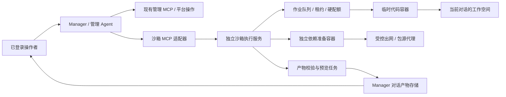

# 管理 Agent 独立代码沙箱完整设计

日期：2026-10-30（Asia/Shanghai）

状态：完整设计提案，已完成独立可实施性审阅及复核，未实施。用户要求完整方案，明确不按 MVP 裁剪。下文的技术选择、默认值和容量是设计建议，不代表已有部署支持或用户已经批准实施。

## 1. 目标与范围

让管理 Agent 在管理对话中编写临时代码、处理数据、安装项目依赖、执行脚本与测试，并把报告、图片、代码、数据文件作为可预览或下载的对话产物交付。

覆盖普通管理对话和显式授权的定时管理巡检。每个对话独立工作空间，文件可跨轮次保留，作业可异步查询与取消；工作空间、作业、依赖、网络和产物均有独立生命周期、配额、审计及恢复规则。

必须具备：

- Python 与 Node.js 运行环境；文件列表、搜索、读写、增量修改、移动和删除。
- 用户文件上传、受控数据导入、项目依赖安装、命令与测试执行。
- 有界日志、退出码、资源用量、超时、取消、排队及运行状态查询。
- 通用对话产物登记、预览、下载和打包导出。
- 普通对话、巡检、浏览器操作和后台维护共用同一执行器及权限约束。
- 真正的容器隔离、硬资源配额、默认断网、受控出网和可靠回收。

完整性指上述能力在正常、失败、并发、重启及删除情况下形成闭环；不等于建设通用云开发平台。

不包括：宿主 Shell、修改运行中的平台源码、直接访问业务数据库、自动部署、嵌套容器、任意镜像、特权容器、GPU、开放服务端口、长期守护进程、交互式终端，以及陌生用户的多租户账户和计费系统。业务 Agent 不自动获得沙箱能力，业务插件继续使用 JSON 契约。

## 2. 当前项目约束

- `src/manager/agent.mjs` 已有对话工作目录，但 Codex home 关联真实登录文件，进程持有管理 MCP token；现有目录不是本方案的代码安全边界。
- `compose.yaml` 的 Manager 挂载管理数据、Codex 登录目录和宿主资源采样目录。代码容器不能继承这些环境、挂载或网络。
- `src/codex/config.mjs` 禁用原生 Shell、patch、JS REPL、浏览器使用。保留这些限制，通过显式沙箱 MCP 工具提供新能力。
- `project_source` 提供部署源码的受限只读访问；源码内容和可执行文件权限必须分开。可以向沙箱复制允许读取的源码快照，不能写回部署目录。
- 管理图片目前有专用保存与下载路径；业务产物属于任务。新增通用管理产物，不把沙箱文件伪装成业务任务产物。
- 现有部署是单操作者或共享管理权限的可信团队。会话隔离约束代码和 Agent 工具身份；不宣称现有 Admin 用户之间已经具备租户隔离。
- 现有历史清理默认关闭。工作区临时文件可以有独立 TTL，但已发布产物不能借此绕过对话历史的保留约定。

## 3. 架构选择

评估三种部署路径：

| 路径 | 能力与代价 | 结论 |
| --- | --- | --- |
| 同机独立执行服务，标准 OCI 容器 | 容易适配现有部署；与平台共享宿主内核，隔离强度有限 | 保留为显式兼容模式，不静默降级采用 |
| 独立执行服务，OCI + gVisor | 增加内核接口隔离，可部署同机专用用户或远程节点；需检查运行时兼容性 | 推荐的默认执行模式 |
| 每作业微虚拟机 | 更强的内核边界；需要虚拟化支持和额外镜像、存储、启动运维 | 记录为后续执行后端，不纳入本次必需实现 |

本设计选择独立执行服务及固定 OCI 接口，默认要求 gVisor 模式。同机与远程节点使用相同协议；生产环境优先把执行节点放在独立 VM 或主机。普通 OCI 兼容模式必须由管理员明确启用，界面显示实际隔离类型。运行时、cgroup、磁盘硬配额或网络策略缺失时拒绝执行；不得仅展示一个已配置但未生效的上限。

执行控制服务以专用系统用户运行，可连接其受控容器运行时。它不以“给 Manager 挂 Docker socket”的方式实现。Manager、代码容器、依赖构建容器、预览容器均不挂载 Docker socket。执行节点的控制权限不得暴露给 Agent，也不得通过通用 Docker API 代理传递。

模型推理、Codex 登录和管理 MCP 保留在 Manager。代码容器只接收必要的作业输入，不运行持有平台权限的 Codex 管理进程。

## 4. 信任边界与身份

### 4.1 不下放的能力

代码容器没有平台、Codex、Admin、执行器控制端或包源认证凭证；不继承宿主环境变量、登录文件、SSH agent、代理认证、云凭证、平台数据库、更新器目录、其他对话文件或宿主 `/proc`。

平台配置、重启、插件管理、业务任务提交和通知继续走现有 MCP；沙箱代码不能直接调用它们。不能因安装了 SDK、输出了一段指令或获得网络策略而取得管理授权。

### 4.2 身份来源

- MCP 使用当前有效 bearer 的服务端执行上下文，推导 conversation/message/source inspection。
- 模型不能指定 owner、宿主路径、容器 ID、挂载、capability、运行时 socket 或自由格式容器参数。
- `job_id`、`artifact_id`、上传 ID、快照 ID、游标均二次检查归属，跨对话请求返回不可访问。
- 浏览器沿用 Admin 登录、同源写校验和现有共享管理模型；读写路由使用明确的对话路径。
- Manager 到执行器使用独立认证，不能复用 `RUNNER_TOKEN`。远程连接使用 TLS/mTLS；控制凭证只由人配置，支持轮换。
- 执行器在自己的记录中绑定 client/owner/workspace/generation，不能只信任调用方提供的一个任意路径。

### 4.3 策略管理

隔离模式、镜像目录、网络策略、最大资源、全局启停和执行节点连接均为人管理的安全配置。Agent 可读取安全元数据，选择当前上下文允许的预设，并申请更低额度；不能通过通用 `configuration_update` 修改安全配置或提高上限。

安全配置使用浏览器专用写路由、版本检查和独立后端授权。仅隐藏表单或 MCP 工具不足以形成权限限制。

## 5. 工作空间与文件系统

一个管理对话对应一个逻辑 workspace；workspace 有稳定 ID 和单调递增 generation。创建按需进行，不因浏览历史启动容器。目录不复用现有 Codex home/work 根目录，存放于执行器的专用受配额文件系统。

建议容器内布局：

| 路径 | 用途 |
| --- | --- |
| `/workspace/project` | Agent 脚本、输入和项目文件 |
| `/workspace/envs` | 当前对话的虚拟环境和项目依赖实例 |
| `/workspace/output` | 待发布文件，仍是可变工作文件 |
| `/tmp` | 有界、随作业销毁的临时空间 |

这些路径共享工作空间总配额或分别具备更小上限；容器可写层、临时目录、日志和构建空间均另有限额，不能藏到配额外。

根文件系统只读。工作容器采用非 root UID、独立 PID/IPC/mount/network namespace、去除 capabilities、禁止提权和设备访问，应用兼容的 seccomp/LSM 策略。基础镜像按 digest 固定，不含平台控制代码或配置。镜像升级不替换运行中作业。

### 5.1 文件操作契约

- 路径为工作空间内相对路径；统一 Unicode/编码规则，拒绝 NUL、目录穿越、绝对宿主路径及平台保留目录写入。
- 列表与搜索分页；文本读取按字节/行范围返回；二进制提供元数据和下载，不直接塞进模型上下文。
- 写入支持 UTF-8、限定二进制上传、原子替换；patch/move/delete 带期望 revision/hash，冲突重读。
- 递归删除需显式参数和大小边界；不能通过空路径删除 workspace，整体清理使用专用 reset。
- 路径检查与实际打开之间不能存在可利用的替换窗口；使用目录句柄及等效 `openat2` 约束，拒绝越界链接、magic link、非普通文件。不能只用字符串前缀检查。
- 导入、导出、发布和读取均不跟随符号链接；拒绝硬链接导出、FIFO、socket、设备文件及未知特殊节点。基础镜像或虚拟环境运行时需要的链接可以在容器内使用，但不因此扩大文件工具范围。

### 5.2 并发一致性

一个 workspace 同时只有一个会修改文件系统的操作：命令、依赖切换、上传落盘、编辑、删除、reset、快照或发布。任意命令都视为可能写入，不能依据模型声称“只读”放宽。

运行时，状态、日志和取消始终可用；文件元数据可返回明确标注的活动视图。文件内容读取、编辑、导出和发布等待工作空间空闲或返回 busy，不对正在变化的文件承诺一致快照。租约由执行器持有并有 fencing generation，Manager 请求超时不会释放一个仍在运行的写入租约。

## 6. 执行、排队与作业状态

支持两种明确命令形式：`argv` 数组，以及在容器内指定的 shell 文本；shell 仅在容器内解释。`cwd` 为相对路径。环境变量使用清单和受限用户变量，禁止覆盖执行器保留字段、预加载控制变量及凭证来源。可提供有界 stdin 或引用本对话输入文件。

`sandbox_exec` 持久接受后立即返回 `job_id`、状态、有效资源/网络/镜像版本。短作业可提供有上限的等待选项，但持久作业身份不能取决于某次 HTTP 连接。

状态：`queued → provisioning → running → succeeded/failed`；取消经 `cancelling → cancelled`。另有 `timed_out`、`oom_killed`、`reconciling`、`lost`。文件清理状态与作业执行状态分别记录。

结果包含：退出码或 null、终止信号、终止原因、排队/开始/结束时间、stdout/stderr 游标与截断标志、CPU/内存/磁盘峰值、策略及镜像版本。资源指标不可获得时明确 unknown，不能填零。

### 6.1 超时与取消

- 排队等待、实际执行、依赖准备和产物转换分别计时；执行时间包括作业子进程，不包括模型等待工具之前的时间。
- 取消是幂等请求。已结束作业返回原状态，不把成功改写为取消。
- 先终止进程树，短暂宽限后强制回收整个 cgroup/容器，确认退出并收齐有界日志后再确认终态。
- 不能确认节点状态时标为 cancelling/reconciling，不谎报“全部进程已停止”。未确认的资源预留不供其他作业重复使用。
- 普通异步作业可以跨对话轮次运行，但受固定最长时间约束；用户取消所属管理执行、该消息超过执行 deadline、删除对话或显式 stop 同时请求终止其未完成作业。Manager 进程重启或浏览器断线本身不等于用户取消，不因此重提或误报作业已停止。
- 不支持绕过执行器留下守护进程；主命令退出时回收遗留子进程。长期工作通过显式受管作业和定时巡检发起。

### 6.2 幂等与恢复

提交使用 workspace generation 内的稳定 `request_key`。相同键和完整参数摘要返回同一作业；不同内容冲突。幂等摘要包含命令、输入内容引用/hash、镜像、环境、有效资源和网络策略。刻意重跑必须新建键，不自动复用未知执行。

Manager 持久保存请求意图；执行器是作业状态的权威来源，在启动容器前持久保存作业 ID。消息结束、取消、预算变更等需要跨服务生效的动作使用事务内意图/outbox，不能只依赖进程 finally 回调。容器带稳定归属和 attempt/generation 标签。网络响应丢失时按原键查询，不再启动第二个容器。

执行器自身重启按标签、租约和退出记录核对已有作业；Manager 重启只查询和重新订阅。节点失联时不转移并重跑未知作业。deadline/watchdog 由执行节点独立执行，不能依赖 Manager 在线。

永久失联节点需要人工 fencing 流程：先将节点隔离、停止接单并撤销其出网租约；由部署者在平台外停止专用执行运行时、销毁/关闭执行 VM，或使用基础设施接口取得同等的停止证据。仅“网络不通”不能证明代码已经停止。Admin 专用接口记录操作者、节点 epoch 和停止证据；人工确认标注为人工证明，不能伪装成系统检测成功。确认停止后将相关作业置为 `lost`（副作用未知），释放其调度预留。无法确认停止时保持未知预留并告警，不能为了继续接单假装回收成功。

节点重新加入必须更换 epoch/凭证，先完成旧标签容器和租约核对、终止及隔离数据处理，不能直接续跑旧作业。旧节点/epoch 的事件和出网请求被拒绝。丢失 workspace 标记 unavailable/lost；只能从有效快照显式恢复到新 generation 或创建新空间，不能把空目录当作原文件已恢复。控制认证的节点 epoch 和出网网关的节点授权一起撤销。

被终止的命令可能已经修改文件、发送被允许的外部请求或留下部分输出；`cancelled/failed/lost` 不承诺回滚副作用。提供执行前快照及用户显式恢复，不能自动恢复目录后重跑命令。

历史清理后保留必要的键摘要/终态 tombstone；过期键拒绝重新执行。workspace reset 产生新 generation，旧请求、上传及文件 revision 失效，旧作业历史保留。

## 7. Python、Node.js 与依赖管理

运行时目录以版本化镜像提供。建议默认组合 Python 3.13 与 Node.js 24；实施时固定精确版本和镜像 digest，并验证常用包兼容性。基础环境包括 Python venv/pip、pytest、Node/npm/内置测试能力；数据分析、绘图、表格及 TypeScript 工具使用经过验证的预设依赖集合或项目依赖安装。

支持：读取环境信息、指定 manifest/lockfile 安装、依赖清单、安装日志、取消、状态查询、切换已完成环境、重置与导出 lockfile。依赖失败不能污染已成功的环境，采用候选目录准备完成后原子切换。运行中作业固定环境 revision，不做就地升级。

### 7.1 分离安装与数据处理

包下载、构建或安装脚本是任意代码执行。它们在独立受限容器内进行，不能挂载当前项目数据、其他对话数据或平台目录，只接收验证后的依赖声明及必要的公开构建输入。

- 默认禁止清单中的凭证 URL、任意 `file:`/git 引用、逃逸路径和未允许的下载目标。
- npm 默认忽略生命周期脚本；Python 默认使用可用 wheel。需要原生构建时选择管理员预设的构建镜像/策略，在无会话数据的环境完成。
- 项目自身的生成、rebuild、测试和初始化脚本在依赖准备后作为普通离线作业运行，可访问本对话文件。
- 私有包源认证留在受信下载服务中，不放入执行器返回值或代码容器。需要特别源时由人配置具名源；Agent 不能提交一个新地址绕过出网策略。
- 完整清单、锁定版本、完整性校验、构建镜像和源策略记录可查询、可导出。

共享缓存只保存按 hash 固定的依赖包，禁止会话容器写共享缓存。可写 venv/node_modules 属于单一 workspace，并计入其配额。缓存命中不能绕过当前源策略；用户上传的私有包不得进入跨对话公共缓存。

## 8. 网络访问与外部数据

预设网络类型：

| 策略 | 用途 | 默认授权 |
| --- | --- | --- |
| `offline` | 本地脚本、测试、报表和文件处理 | 普通代码执行默认 |
| `packages` | 下载已允许包源的依赖 | 仅依赖准备流程可用 |
| 具名 public-data 策略 | 通过 HTTP 代发网关访问管理员允许的公共数据/API | 明确授权给会话或巡检后可选，默认仅 GET/HEAD |

不提供 unrestricted 模式。模型只能选择上下文已允许的具名策略。包源策略不能用于读取会话文件的普通命令。

本设计不采用透明的 HTTPS CONNECT 隧道来承诺 HTTP 方法过滤。代码容器只有到当前作业受限 HTTP 代发入口的连接，没有直接 Internet 路由；该入口与执行器控制 API 分离，按作业网络身份、有效策略和预算鉴权。提供 Python/Node 轻量客户端，以目标 URL、方法、允许头和有界请求体提交请求，网关使用正常 TLS 校验访问上游，因此能够验证方法、域名、解析地址、每次重定向和响应大小。普通脚本不能把这个入口当成任意 TCP 代理。

包管理使用专用受控 registry/index 下载代理，出网仍由受信请求端发起；私有源凭证只在请求端。代码无需安装用于解密任意第三方 HTTPS 的根证书。需要直接联网、证书绑定 SDK、WebSocket、任意 CONNECT、UDP/QUIC 或自定义 DNS 的包明确返回当前策略不支持，不绕过代理；这类协议如需开放，应另行增加与之相符的执行策略。

网关限定协议/端口、HTTP 方法、请求头、重定向、DNS 与解析后地址、连接数、流量和速率。public-data 默认 GET/HEAD；需要写入的外部 API 由人配置具名策略显式允许具体方法。出网意味着请求内容会发送给允许的目标，不能宣称使用 GET 就能阻止所有数据外传。离线执行仍是默认。

默认阻止宿主、平台服务网段、loopback/link-local、私网、云元数据、IPv6 对应地址及其他内部目的地。出网代理的访问控制必须区分它自己的服务地址和代码可访问的上游。代码不能借 public-data 域名 CNAME 或重定向访问内网。

有认证的企业接口优先继续使用现有受控 MCP/具名 HTTP 目标，将允许的数据显式导入工作空间；不把平台认证头交给脚本。此方案不提供代码中的任意生产网访问。

网络策略有 revision 和最长租约。管理员禁用或收紧策略时，立即拒绝新连接、关闭受控存量连接并更新作业网络状态；无法确保即时撤销时，终止受影响作业。扩大权限仅对后续作业生效，不热升级已有作业权限。

## 9. 资源、容量与自主使用额度

以下为可配置的设计起点，必须经过实测，不能作为已验证容量宣传：

| 项目 | 建议默认 | 约束 |
| --- | --- | --- |
| 单作业 CPU | 1 vCPU | 内核硬限制 |
| 单作业内存 | 1 GiB | 含子进程和 tmpfs；限制 swap |
| 单作业进程数 | 128 | 包括线程、子进程，防 fork bomb |
| 工作空间 | 2 GiB、10,000 个文件 | 字节和 inode 均有硬上限 |
| 临时空间 | 128 MiB | 计入内存/磁盘预算，不是额外无限空间 |
| 命令时间 | 默认 120 秒，预设上限 15 分钟 | 长作业可选择人已批准的更长 profile，最长仍有限 |
| 依赖准备时间 | 10 分钟 | 构建阶段独立配额及 deadline |
| stdout/stderr | 每流保留 5 MiB | 始终排空管道；超限截断或环形保留，不堵死子进程 |
| 单次工具日志回包 | 16 KiB | 分页，不向模型直接回传完整日志 |
| 文件上传 | 单文件 100 MiB | 同时受 workspace 总配额和传输预算约束 |
| 发布产物 | 单文件 50 MiB、单批 200 MiB | 可配置，支持受限分块传输 |
| 全局运行并发 | 默认 1 | 可调，按配置的总 CPU/内存/磁盘预算预留 |
| 单 workspace 并发 | 1 个写操作 | 保证文件一致性 |
| 队列 | 全局 64、每对话 8 | 公平调度，排队有 deadline |

每条管理消息还有限制提交次数、累计 CPU/执行时长、依赖下载和产物字节的预算，建议普通消息默认最多 20 个作业及累计 15 分钟执行时间。巡检使用计划授权的独立预算。重复模型调用、恢复和子 Agent 共享同一预算，不能通过换请求键或开子进程规避。

额度由服务端记账，Agent 可读剩余额度并选择更小规格，不能自行提高。排队时预留，实际结束后结算；未确认退出的作业继续占用预留。配额耗尽返回明确原因与可操作状态，不自动创建新对话躲避限制。

磁盘不能仅使用“执行结束后检查目录大小”。执行节点必须具备可验证的 project quota、受限卷或等效存储后端，对工作空间、安装临时目录、容器可写层、日志、缓存和产物分别有界。全局磁盘低水位时停止接单并清理可回收缓存，不能删除未到期用户产物。

## 10. 输入、快照与源码副本

支持上传普通文件、文本和受限项目压缩包；上传先进入临时区，检查大小/hash/归属并原子落盘。清单展示文件类型和来源。

压缩包解包在受限任务中进行，限制总展开字节、文件数、压缩比及嵌套深度，拒绝路径穿越和链接。超限或取消清理候选输入，不留下半个项目替换原目录。

平台数据从现有 MCP 的授权查询结果显式写入；不提供直接挂载 SQLite 或宿主文件的快捷入口。用户聊天上传的图片/文件可通过本对话附件 ID 复制，不能引用其他会话附件。

源码测试提供 `sandbox_import_source`：只复制 `project_source` 已允许读取的部署文件及明确选择的路径，记录 source revision/hash。源码是参考数据，不执行宿主构建脚本，也不带仓库凭证和隐藏运行文件。沙箱内可以编辑副本、运行测试、生成 diff/patch 并发布下载，不提供自动应用补丁、合并或部署操作。

此自动导入能力只保证允许读取的文件副本，不代表完整平台仓库。必须返回文件清单、source revision、未包含内容和可识别的依赖缺失，不声称因此能运行平台全套测试。需要完整项目时，操作者可以通过文件上传导入自己提供的无凭证源码包及 lockfile；它作为本对话输入，与任意其他项目使用相同的解包/配额/执行限制。该方式不扩大 `project_source`，也不创建读取宿主仓库的后门。完整源码包可以运行已批准环境支持的测试；真实部署、宿主特权、嵌套容器和不支持的浏览器/硬件测试仍交给外部 CI，不把代码测试通过等同于生产验证。

支持显式创建、列出、恢复和删除 workspace 快照；快照在空闲时生成，不包含容器内存/进程。快照有独立容量上限和 TTL，默认最多 3 份；恢复需 generation/CAS 检查且没有活动作业。快照不能恢复已发送的网络请求、已发布产物或外部副作用。

## 11. 产物登记、预览与下载

`sandbox_publish` 在 workspace 空闲并锁定 generation 时校验路径、大小和文件类型，创建不可变副本和内容 hash；发布成功后，继续编辑或清空工作目录不影响已交付文件。

新增管理通用产物目录和元数据，关联 conversation、原始 message、job、文件名、MIME、大小、hash、来源和创建时间。由 Manager 保存到专用产物区，代码容器不能访问此区或元数据库。大文件按受限流传输，不把字节塞进管理数据库或 MCP JSON。

| 文件类型 | 管理页行为 |
| --- | --- |
| 文本、代码、JSON、Markdown | 有界文本/语法显示；Markdown 禁止原始脚本及危险链接 |
| CSV、表格 | 分页/抽样数据预览；行列和解析资源有界 |
| PNG/JPEG/WebP | 有界解码、像素校验后的图片预览 |
| HTML/SVG | 默认静态净化/安全转换；原文件以附件下载，不在 Admin 同源执行 |
| PDF | 隔离转换得到受限预览；原件可下载，不能在管理页面执行内嵌脚本 |
| ZIP、Office、未知二进制 | 下载，附类型和大小；按需生成受限派生预览 |

解析和转换不在拥有平台权限的 Manager 主进程中处理任意文档；作为无网、低权限、有限资源的转换作业执行。转换失败不改变原文件发布成功状态，界面区分“已保存”和“预览不可用”。

下载使用现有登录认证和会话归属检查、服务端生成路径、安全 Content-Disposition、正确 MIME 与 nosniff，不暴露宿主路径，不生成永久公共 URL。支持有界 Range；每个新请求重新认证。删除后拒绝新下载，已经交付的字节无法撤回。

业务产物、现有原生管理图片和新沙箱产物保留各自存储责任，前端合并成统一附件展示，避免重复登记或破坏旧图片下载。

## 12. MCP 与 Admin API

拟定管理工具如下，实施时统一 schema，不暴露 Docker 细节：

| 工具 | 主要作用 |
| --- | --- |
| `sandbox_context` | 环境能力、当前 generation、允许的资源/网络预设、剩余额度、空间占用、工作区是否过期 |
| `sandbox_files` | 分页列表/搜索/读取、创建、原子写入、patch、move、删除，带必要 CAS |
| `sandbox_exec` | argv/shell、cwd、stdin、预设、有效 deadline、稳定 request_key；返回 job |
| `sandbox_job` | 单作业状态、分页日志、资源结果、取消；只操作当前对话作业 |
| `sandbox_jobs` | 当前对话作业列表及游标 |
| `sandbox_dependencies` | 环境清单、依赖准备、查询、取消、切换、重置；不允许任意新源 |
| `sandbox_import` | 当前对话附件/上传、授权数据及受限压缩包导入 |
| `sandbox_import_source` | 允许读取的部署源码快照副本 |
| `sandbox_publish` | 登记本对话稳定产物，返回附件 ID 和预览元数据 |
| `sandbox_artifacts` | 当前对话已发布产物和导出任务状态 |
| `sandbox_snapshot` | 有配额的文件快照及显式恢复 |
| `sandbox_reset` | 空闲工作空间整体清理、generation 递增；保留已发布产物和作业历史 |

Agent 的文件回包和日志均有 token/字节预算。工具说明明确代码可写、测试可运行，但作用域仅为独立沙箱；输出内容不能授权管理操作。

浏览器路由归在 `/admin/api/conversations/:id/sandbox/...`，覆盖 context、files、uploads、jobs、dependencies、snapshots 和 artifacts。安全配置独立 `/admin/api/sandbox-settings` 人工路由，不放到 Agent 可写配置组。通用管理 operations 路由和内部 API 必须同样拒绝越权，不能存在第二条未校验写路径。

作业事件可复用认证 SSE 基础设施，按 conversation/job 序号增量发送，断线后通过游标补查。轮询/订阅从不自动重发执行请求。

## 13. 管理页面与 Agent 使用行为

对话增加沙箱入口，提供四个视图：文件与编辑、作业与日志、环境与依赖、已发布产物。普通对话不因查看而创建空工作区。

- 文件树、类型/大小、上传、下载、受限编辑及版本冲突提示；活动作业期间明确展示写锁。
- 作业卡展示命令摘要、资源/网络预设、排队/运行状态、日志、耗时、退出码和取消入口。
- 环境页显示 Python/Node 精确版本、依赖清单、准备进度和失败原因。
- 产物在消息下和对话产物页展示，支持安全预览、单文件下载和受限打包导出。
- 提供工作区占用、到期时间、额度、暂停/不可用原因；区分重置临时文件和删除正式产物。
- 停用沙箱后保留历史查看、取消和下载能力；不允许新执行。退出登录清除页面草稿和订阅，不让异步旧请求写回其他会话。
- 支持中英文、键盘、屏幕阅读器和手机；大日志虚拟/分页显示，不使聊天页面随日志无限增长。

Agent 的建议流程：读取 context → 导入必要数据 → 写代码 → 使用已允许环境/依赖 → 提交并查询作业 → 根据结果修改与测试 → 发布需要交付的文件。根据任务需求自主调用，无须对每条已授权沙箱命令重复请求确认。风险策略、额外网络来源和更高资源由人预先配置，不能通过提示词自我授权。

最终回复区分“脚本退出成功”“测试通过”“业务结论正确”；测试数量、失败原因和产物 ID 以实际记录为准，不用模拟输出替代真实执行。不把临时宿主路径当成可下载链接。

## 14. 定时巡检与其他 Agent 的边界

定时管理巡检完整支持本套工具，但需在计划上选择管理员允许用于 scheduled execution 的沙箱 profile/网络预设和预算。旧计划默认没有沙箱授权，不自动获得代码执行能力。

每次巡检触发生成独立管理对话及 workspace；绑定/预算复制到此次执行，编辑计划只影响未来触发。原始巡检消息只使用该次已绑定的授权集合，不允许通过修改自身计划、当前对话设置或安全配置扩大本次权限。

巡检执行与其受管子 Agent 共享 workspace、写锁和预算；不因模型子 Agent 数量增加并发或额度。原始消息终态结束或取消时，在同一本地状态事务内写入撤销/取消意图，再由 outbox 请求取消仍活动的子作业并保存结果；确认前如实显示取消待同步，不能在控制链路断开时宣称物理进程已停止。后续人为对话可以查询历史，根据普通对话当前授权开始新工作。

本次不自动开放业务执行 Agent。将来如需复用，应作为显式业务 capability 接入同一执行器，使用 task/run/generation 身份和独立预算，不改变业务插件仍为 JSON 的契约。

## 15. 持久化与跨服务一致性

执行器拥有 workspace、generation、作业、运行时标签、租约、策略执行快照、依赖环境、快照和临时文件回收记录。Manager 拥有对话/消息关联、提交意图、展示索引、正式产物目录以及删除 outbox。

拟定数据集合：`sandbox_workspaces`、`sandbox_jobs`、`sandbox_job_events`、`sandbox_requests`、`sandbox_environments`、`sandbox_snapshots`、`sandbox_quotas`、`sandbox_cleanup`；Manager 侧保存 `manager_sandbox_requests`、`manager_artifacts`、`manager_sandbox_cleanup`。具体建表和索引由实施者决定，归属和事务边界不能合并为共享平台数据库挂载。

跨服务提交、发布与删除都使用稳定操作 ID 和幂等回包。正式产物流程为 reserve → 有界复制并验 hash → 元数据提交 → 可下载；失败清理候选文件。元数据提交后丢失响应时按原操作查询，不产生重复附件。

对话删除在本地事务内写清理 outbox 和拒绝后续访问的 tombstone，执行器终止作业、清理数据后确认。对话记录可以从页面消失，但清理重试记录不能随之丢失。离线执行节点恢复后先对账 tombstone 和孤儿任务，不能恢复已删除对话的代码执行。

## 16. 保留、清理、备份与审计

- 临时工作区默认闲置 7 天到期；闲置指没有活动作业/传输/写入租约，不能仅看最后一条聊天时间。
- 临时上传、失败构建目录、过期快照和中断的产物候选有更短 TTL，清理由归属服务限量进行并可重试。
- 作业日志默认保留 7 天，结果/审计元数据默认保留 30 天；对话历史更早删除时一并删除。必要的幂等 tombstone 保留至对话删除。
- 已发布产物跟随对话历史保留规则。现有自动历史清理默认关闭，本功能不擅自开启或缩短其期限。
- workspace 到期不删除聊天和已发布产物；再次使用需明确返回已过期/新 generation，不能假装旧文件仍存在。
- 管理员可显式清理/导出/删除；会话 reset 保留正式产物。涉及正在运行作业的整体删除使用 cancel-and-delete 状态流程，不能直接 unlink 后宣告完成。
- 缓存有全局 LRU 与最大容量，不清理活跃环境或未到期私有数据。日志轮转、磁盘水位和清理积压有告警。
- 备份默认包括 Manager 正式产物和相关元数据；临时工作区/缓存可排除。备份与恢复必须保留 owner/generation/hash，不能恢复后自动重跑历史作业。

命令、源代码、stdin、文件内容和完整日志可能含用户数据。通用活动流只记录操作名、ID、摘要和状态；不能把原始工具参数及大输出复制到所有管理动作记录。详细内容保存在本对话授权的有界记录中，已知控制凭证在日志中脱敏，文件字节不进入常规日志。

审计记录人/Agent/巡检来源、消息、工作区代次、请求键摘要、策略/镜像版本、配额、时间、终态和清理结果。不能宣称脱敏能识别任意用户秘密；避免凭证进入环境比事后过滤更重要。

## 17. 部署、健康与可观测性

新增执行服务及可选独立出网服务；它们属于执行基础设施，不改变现有 Gateway、Runner、Manager 的业务职责。Manager 配置中只保存执行器连接和功能状态，工作容器不加入现有平台服务网络。

执行服务建议作为专用用户的宿主服务或独立节点服务运行，控制固定 rootless OCI 运行时。远程部署不需要 Manager 挂载执行节点磁盘。部署文档提供同机/远程两种明确拓扑，不把宿主服务伪装成无须额外安装的普通 Compose 容器。

安装与启动检查包括：运行时和隔离类型、cgroup v2 委派、CPU/内存/PID/swap 限制、文件和可写层硬配额、UID 映射、出网策略及旁路阻断、时钟/deadline、镜像版本/架构、控制认证和磁盘余量。必须实际执行受限探针证明上限生效，检查失败返回 unavailable，不进入无限制模式。

部署 bootstrap 负责端点、证书、运行时与存储；日常安全策略由人通过版本化设置管理。Agent 仅发现 capability 和 readiness，不能安装宿主运行时、修改防火墙或重启执行宿主。升级先 drain 新作业，保留运行作业使用的镜像和环境，版本不兼容时不接单。

健康指标包括排队数、执行数、失败原因、租约超期、节点失联、取消耗时、CPU/内存/磁盘、缓存命中、网络拒绝、配额耗尽和清理积压。执行器不可用时管理聊天和其他 MCP 仍可工作，返回明确的沙箱不可用原因。

## 18. 现有代码和规则需要同步修改的范围

1. 新增独立 `sandbox` 协议/执行模块和执行服务入口；不把生命周期塞入通用 capabilities 或管理页面。
2. 管理工具契约、MCP 上下文、操作适配器、作业事件投影、预算和安全审计。
3. Manager 通用产物元数据、私有文件存储、上传/下载/预览路由及清理 outbox。
4. 普通对话与巡检的上下文授权、取消/结束/恢复和清理协调。
5. Admin 沙箱工作区、文件/作业/依赖/产物界面、独立安全设置、中英文与小屏。
6. 版本化平台规则、`AGENTS.md`、管理提示词、架构/部署/运维文档、可读源码 allowlist 和发布资源验证。
7. 独立执行器安装、镜像构建与更新、rootless/隔离/硬配额探针、出网规则和备份说明。

规则应精确表述为“允许使用显式工具在独立沙箱内写代码、安装允许的依赖、运行脚本与测试”，同时保留平台源码写回、任意宿主 Shell/SQL、Docker socket 和管理权限绕过的禁止。不能为了本功能移除通用原生工具策略。

## 19. 完整验收标准

实现不能仅以“运行 hello world”宣告完成，至少覆盖：

- 两个管理对话的文件、作业、上传、快照、依赖和产物互不可借用；伪造 ID/token/generation 均拒绝。
- Python/Node 写脚本、安装纯依赖/受控原生依赖、运行真实测试、读日志、修改重跑、发布报告/图片/代码、重开对话继续工作。
- 文件穿越、链接/硬链接、目录替换竞态、特殊文件、压缩炸弹、超大文件、超量 inode 和并发修改均不越界。
- 子进程/fork、内存、CPU、磁盘、日志洪泛、永不退出、忽略 SIGTERM 的作业被真实限制；stdout 截断不造成管道阻塞。
- 默认无网，允许源可用，非法目标、内网、metadata、IPv6、DNS rebinding、重定向和 CONNECT 旁路被拒绝；撤销策略使存量权限失效。
- 安装脚本看不到会话输入/平台凭证，失败安装不损坏当前环境，共享缓存不能被会话污染。
- 同键提交、HTTP 丢响应、Manager/执行器重启、容器启动不确定、取消竞态、节点失联、产物提交丢响应和删除失败均不重复执行或虚报成功。
- 原始巡检绑定、预算、后续对话、计划修改和自身提权限制正确；子 Agent 不能绕过额度。
- HTML/SVG/PDF/图片等恶意产物不能在 Admin 同源执行、读取 cookie 或消耗无限解析资源；下载有真实认证。
- 临时 TTL、正式产物保留、活动租约保护、对话删除 outbox、孤儿回收、备份恢复和磁盘低水位处理真实有效。
- 测试只使用合成数据、无认证本地模型 fixture 和本机回调/测试源，不读取真实登录凭证或发送真实业务请求。
- Node 全量测试、实际容器隔离与配额测试、受控网络测试、浏览器交互/中英文/手机、打包和各部署目标均有证据；危险隔离探针在专用测试节点中运行。

## 20. 后续设计核对与实施交接

实施前以部署探针核实推荐 rootless OCI + gVisor、存储硬配额和目标 Linux 环境的组合兼容性；这是落地验证项，不是允许无隔离回退的理由。若组合不支持，应明确更换执行节点/存储或由管理员选择已说明边界的兼容模式。普通 OCI 兼容模式也必须满足硬配额、认证和网络限制，不能把缺失配额当作兼容选项。

具体索引、队列实现、前端编辑器和预览库由实施者在本设计边界内选择。若需要开放任意公网、生产内网、宿主构建或业务 Agent 自动代码执行，属于权限范围变化，需要另行设计，不能作为普通实现细节加入。

本设计完成独立可实施性审阅并得到用户认可后，再拆解实施计划；不以删减上述生命周期、隔离、恢复和运维能力的方式转换为 MVP。

## 21. 独立审阅处理记录

首次独立可实施性审阅提出三项重要问题，已由设计方明确建议：

1. HTTPS 方法过滤采用独立 HTTP 代发/包源代理，拒绝不受控 CONNECT 隧道，不把 TLS 加密流量当成可见 HTTP。
2. 永久失联节点通过管理员外部停止证明和 fencing/epoch 流程回收；无法确认时保留未知状态，恢复节点不能续跑旧作业。
3. 自动源码导入保持现有可读 allowlist；完整项目由操作者提供源码包，不承诺受限副本可以运行平台全套测试。

同时明确普通后台作业在 Manager 重启时只对账、巡检终态取消意图须事务内持久化，以及任何运行时模式均不能省略硬配额。上述选择仍属于本设计的建议，实施前可由用户调整。

独立复核结论：上述三项已闭合，没有必须先补充的重要实施决策。部署兼容性、硬配额和出网隔离仍须在实施阶段使用真实探针验证，不以设计审阅代替运行验证。
